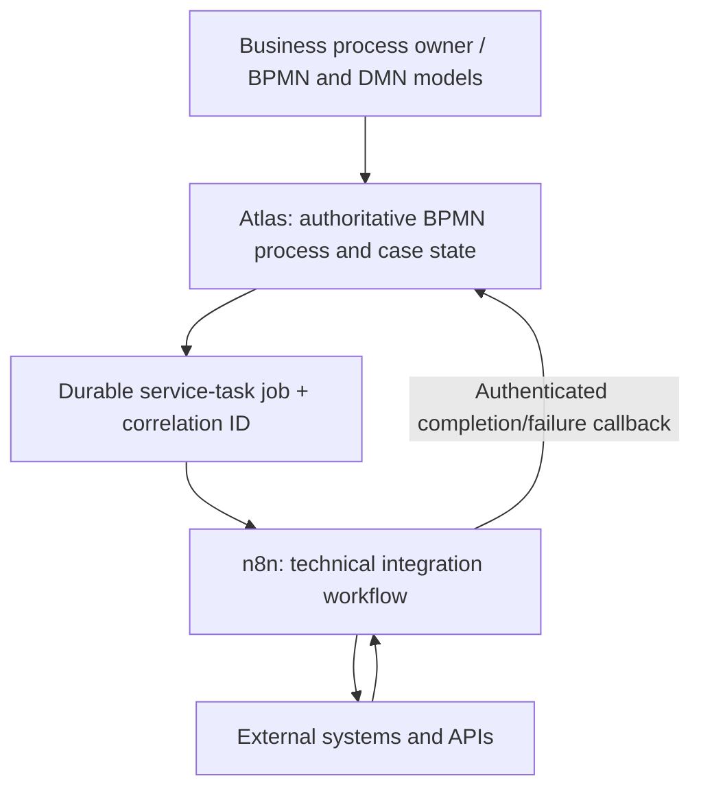

# n8n and Atlas: an enterprise architecture decision guide

> **Languages:** English (this document) · [Deutsch](n8n.de.md)
>
> **Purpose.** This document supports architecture and platform decisions when
> one team has adopted n8n for automation and another evaluates Atlas for
> business process automation. It is **not** a vendor ranking or a claim that
> one product should replace the other.
>
> **Reviewed:** 2026-10-13 against the linked product and project documentation.
> Capabilities and edition entitlements change: verify the version, deployment
> configuration, and licence relevant to an actual decision.
>
> **Maturity warning.** Atlas remains a **developer preview (0.x)** with unstable
> APIs and on-disk formats; the [README](../../README.md) explicitly says it is
> not ready for production use. n8n is an established cloud/self-hosted product.
> A better *architectural fit* must not be mistaken for *production readiness*.

## Executive summary

**The decision is not whether n8n can run a business workflow. It can.** n8n
supports persistent waits, webhooks, forms and human approvals, execution
history, retries, and scaled execution in queue mode. Describing it as suitable
only for short-lived integrations would be inaccurate.

**The distinction is where authoritative business process state belongs.**

- **n8n** makes application integration and technical workflow automation
  approachable through an extensive node catalogue, credentials, data mappings,
  and interactive execution tools. It can also orchestrate longer and
  human-involved workflows.
- **Atlas** makes the *business process* an explicit execution object: BPMN
  process and element instances, events, gateways, user tasks, timers,
  incidents, jobs, variables, and durable process history. Business decisions
  can be expressed with FEEL/DMN via Temis.
- **Both** can satisfy overlapping use cases. BPMN and DMN are reasons to
  consider Atlas **when they are genuine requirements**, not automatic proof
  that an n8n implementation is unacceptable.
- **Today**, n8n has a decisive advantage in operational maturity, integration
  breadth, and established scaling and support models. Atlas's specialized
  execution design is promising but does **not** yet constitute a demonstrated
  production alternative for critical enterprise-wide workloads.

> **Decision principle:** Select and govern an automation platform according
> to the kind of work being automated, the owner of the authoritative state,
> the required semantics and evidence, and the operational risk—not the
> organisational influence of its sponsor or the appearance of its canvas.

A coherent enterprise architecture can use **n8n for technical integrations**
and **Atlas for a bounded class of BPMN-driven business processes**. This is
an option to validate, **not** a mandatory two-product architecture. Simple
automations should remain simple.

## 1. What is the architectural decision?

"Workflow" has several meanings. Calling both products workflow engines does
not settle whether they should serve the same enterprise responsibility.

| Responsibility | Central questions | Typical fit |
|---|---|---|
| **Integration automation** | How do we move, transform, or synchronize data and invoke APIs? | n8n is often the simpler choice. |
| **Business process orchestration** | What is the state of the business case, which event changes it, who is responsible, and what happens after a wait or failure? | Atlas is a candidate when executable BPMN semantics are required. n8n can also implement such flows with its native constructs. |
| **Business decision management** | Where are business rules defined, versioned, evaluated, and explained? | Atlas + Temis provide a DMN-oriented path; n8n can call an external rules service or implement rules in expressions/code. |
| **Human work management** | Who may claim/complete work, what deadlines apply, and how does work relate to a case? | Evaluate the actual task requirements. Atlas models BPMN user tasks; n8n supports forms/approval flows and can integrate a task system. |
| **Operations and governance** | Who runs it, protects data, responds to incidents, upgrades it, and supplies support? | n8n currently has a substantial maturity advantage. Atlas requires a bounded adoption plan and explicit risk acceptance. |

The **enterprise automation architecture** should assign ownership for these
responsibilities. A product choice in one domain should not silently become a
mandate for every kind of automation.

### Avoid false dichotomies

- n8n **can** execute long-running workflows; its
  [Wait node](https://docs.n8n.io/integrations/builtin/core-nodes/n8n-nodes-base.wait/)
  stores suspended execution data and resumes it on time, webhook, or form
  submission.
- n8n **can** involve humans through forms, messages, and approval
  interactions. It is not "machine-only".
- Atlas **can** perform integrations through Worker Types and external jobs.
  It is not "BPMN-only without connectivity".
- BPMN notation **does not by itself** guarantee complete conformance,
  usability by business users, or interoperability with every modeller.
- Event sourcing and deterministic replay **do not guarantee exactly-once
  external effects**, legally complete audit records, or zero data-loss risk
  without appropriate deployment and testing.

## 2. Evidence levels and current maturity

Use these terms consistently:

| Label | Meaning |
|---|---|
| **Documented / implemented** | The current Atlas README, ADR, code-level coverage, or operations documentation describes a feature as implemented. The buyer still verifies it in the target version. |
| **Demonstrated** | The requirement has been exercised in a reproducible test, with recorded evidence and agreed acceptance conditions. |
| **Planned / architectural** | A roadmap or ADR describes the target; it must not be scored as available functionality. |
| **Production-proven** | A supported operating model and real deployment evidence exist at the required scale, availability, and security level. |

Atlas's [conformance coverage](../../conformance/COVERAGE.md) includes
registered scenarios for user tasks, messages, timers, gateways, subprocesses,
multi-instance activities, compensation, and incidents. This is substantial
**implementation evidence**, but "all registered scenarios covered" does
**not** equal independent certification of full BPMN 2.0 compliance or a
production-service guarantee.

Atlas also documents a browser-based modeler, Tasks app, operations views,
process replay, workers, a DMN editor and decision evaluations; see the
[README](../../README.md), [roadmap](../../ROADMAP.md), and
[worker execution ADR](../adr/0203-worker-execution-model.md). The comparison
must not downgrade implemented features to aspirations. Conversely, a UI
showing a model element is not evidence that every execution semantic works.

For n8n, a feature's availability can depend on **Cloud vs. self-hosted,
edition, licence, and deployment mode**. Check its
[edition overview](https://docs.n8n.io/hosting/community-edition-features/)
and official docs rather than assuming all capabilities are present in a
self-hosted Community installation.

## 3. Decision matrix: fit is different from readiness

"Fit" below is a product-design observation, **not** a benchmark result or
an organisational approval.

| Requirement or concern | n8n | Atlas | What the decision must verify |
|---|---|---|---|
| Rapid SaaS/API/data integration | **Strong fit**; broad node and credential ecosystem | Worker Types, REST/API and custom workers; smaller catalogue | Required systems, ownership, maintenance and credentials |
| Executable **BPMN 2.x** as the authoritative model | No native BPMN execution contract; n8n node graph | **Core design and substantial implemented coverage** | Required BPMN patterns and extension portability |
| Wait for days/weeks or callback | **Supported** through waits and persisted executions | **Core use case** with timers/messages and process state | Recovery, timeouts and lifecycle rules |
| Human tasks | Forms/approval interactions and external task systems | BPMN user tasks, assignments and worklist model | Delegation, substitution, access rules, deadline handling |
| Business decisions as **DMN** | External rules service or workflow-specific logic | Temis/DMN and FEEL integration, with editor and decision records | Rule ownership, traceability and version behaviour |
| Operational diagnosis of integrations | **Mature** node-level testing, execution data and retry tools | Jobs, incidents, process views and history; younger UX | Operator workflows and runbooks |
| Reconstruct business process state after crash | Execution persistence and recovery mechanisms | Event log and deterministic state replay are design invariants | Crash tests; distinguish engine state from external side effects |
| Horizontal execution scaling | **Established queue mode**; worker replicas | Partition-oriented design; enterprise scale-out still a target | Real topology, availability and throughput under load |
| High availability | Available patterns and edition-dependent capabilities | **Not demonstrated as a supported multi-replica Atlas deployment** | Failover, split-brain protection and recovery objectives |
| Enterprise identity and governance | Edition-dependent product features | OIDC/RBAC and other controls implemented; security gaps remain | Required IdP, object-level permissions, secrets and audit |
| Licensing and commercial support | Sustainable Use License; commercial offerings | **AGPL-3.0-only**; project/community-based support | Legal review, enterprise support and long-term ownership |
| Production use now | **Established option**, subject to enterprise assessment | **Developer preview; not production-ready** | Mandatory risk/security/operations gates |

The strongest differentiation of Atlas is **formal process semantics and a
process-centric operating model**, not a claim that n8n cannot build equivalent
business outcomes.

## 4. Modelling and process semantics

An n8n workflow is a proprietary **executable node graph** for triggers,
integrations, transforms, conditions, loops and sub-workflows. Its editor makes
technical automation and data inspection fast. The model is not a BPMN
interchange artifact and does not promise BPMN execution semantics.

Atlas compiles BPMN XML to an executable process graph. BPMN gives events,
activities, boundary behavior, scopes, gateways, call activities and
multi-instance execution defined meanings. This provides a potential common
reference for business analysts, process owners, automation engineers and
operators—**provided those roles are trained and the supported subset is
explicitly governed**.

An executable BPMN model can reduce the gap between process documentation and
execution. It does not automatically eliminate implementation-specific
extensions, ambiguous requirements, or governance work.

Relevant evidence:
[Atlas BPMN coverage](../../conformance/COVERAGE.md),
[architecture](../ARCHITECTURE.md), and
[enterprise architecture](../architecture/enterprise-architecture.md).

## 5. Long-running cases and authoritative state

The important question is **not** "Can it wait?" Both systems can.

For a business case lasting weeks, an enterprise may need to explain:

- Which business process instance and process-definition version are active?
- Which tasks, timers, messages and boundary conditions are currently pending?
- Who owns the next business action, and what deadline applies?
- Which decision rule and evaluated inputs determined an outcome?
- What remains correct if a worker fails, a callback is duplicated, or the
  server restarts?
- Which information must be retained, archived or erased?

Atlas makes many of these concepts native process-engine concerns. n8n
primarily presents workflow executions, nodes, input/output data and their
status; the same business-case view may be built using conventions, a data
store, or another application. Neither architecture avoids the need for
domain-specific data models.

**Practical test:** ask each implementation to show the state of one open case
and explain the same case after a crash, an expiry, a manual reassignment and
a process update. Compare the evidence and maintenance burden, not the number
of shapes drawn on the canvas.

## 6. Human work and decision management

### Human tasks

n8n can gather input through forms, wait for human responses, send approval
requests and delegate more elaborate task management to another system.
This is enough for many cases.

Atlas implements BPMN user tasks and documents task assignment, claiming,
forms and scheduling in its project ADRs and UI. For example,
[assignment and claiming](../adr/0042-user-task-assignment-and-claim.md)
and [user task scheduling](../adr/0091-user-task-scheduling.md).

A PoC should specifically check candidate groups, reassignment, substitute
users, due dates, authorization boundaries, task completion history, and how
each tool handles forms for real users. Do not infer production-quality
workforce management from "user task exists."

### FEEL and DMN

n8n conditions, expressions, Code nodes and external decision services can
implement business rules. For small or developer-owned rules, that can be
perfectly appropriate.

Atlas integrates FEEL and DMN through
[Temis](https://github.com/pblumer/temis) for BPMN business rule tasks;
[ADR-0014](../adr/0014-dmn-business-rule-tasks-via-temis.md) documents
the execution boundary, and
[ADR-0062](../adr/0062-embedded-dmn-editor.md) documents the embedded
DMN-editor direction and implementation.

DMN is most valuable where **rule ownership, independent review, versioning
and explanation** matter. The PoC must still show which rule version was
executed, what was recorded, and how changes affect already running cases.
A claim that business rules can be changed without any deployment implications
would be too broad.

## 7. Integrations and developer experience

n8n's [integration catalogue](https://n8n.io/integrations/) is a major
advantage: ready-made nodes, credentials, expressions, data previews, execution
history, error handling and templates reduce integration effort.

Atlas's service-task boundary creates durable jobs that Worker Types and
workers consume. Current Atlas documentation includes selected integrations,
external workers, credential handling and a modeler; these are not merely
hypothetical features. However, the catalogue and developer experience should
not be represented as matching n8n's breadth.

Atlas should **not** pursue a large n8n-style integration catalogue as a
strategic objective. Prefer durable, well-specified worker contracts and
selected high-value worker implementations. A direct Atlas worker is often
simpler than introducing n8n for a single HTTP request.

**Governance question:** if both platforms exist, which team owns each
connector, secret, service account and API contract? Avoid duplicate
integrations with inconsistent policies.

## 8. Execution, failure handling and performance

### n8n

n8n stores workflow/execution state and provides error workflows, retries,
diagnosis and manual re-execution. In
[queue mode](https://docs.n8n.io/hosting/scaling/queue-mode/), a main
instance receives triggers while Redis distributes jobs to workers using
shared database-backed execution data. This is an established technical
scaling model, subject to the required storage and configuration choices.

Execution-history availability is a configurable operational concern, not
automatically a permanent compliance archive. For example, n8n's
[execution view](https://docs.n8n.io/workflows/executions/all-executions/)
explains how workflow deletion affects history.

### Atlas

Atlas uses an append-only write-ahead log and a materialized state store.
Its principal [invariants](../architecture/invariants.md) include:

1. A single writer per partition.
2. A durability boundary before externally visible engine effects.
3. The same deterministic event-application path for live processing and
   recovery.
4. Compiled process structures and expressions outside the execution hot path.

This is a specialized model for reconstructing *engine state*. It is **not**
a universal guarantee that an external API operation happens exactly once.
Workers and integrations still require idempotency, correlation, retry policy
and reconciliation with external systems. Similarly, a process-event history
does not alone prove regulatory audit completeness or retention compliance.

### Performance and scaling claims

Do **not** present Atlas as faster than n8n without an agreed workload.
Atlas's batch/WAL architecture may be efficient for durable state transitions,
while n8n's throughput depends on workflow design, payloads, API latencies,
queue settings and external rate limits. Such workloads are not inherently
comparable.

Most importantly: the current
[Atlas Helm deployment](../../deploy/README.md) specifies **one StatefulSet
replica** and an exclusive persistent volume. Horizontal partition
replication/high availability remains future work
([roadmap](../../ROADMAP.md);
[open compliance points](../compliance/isds-offene-punkte.md)).
Architecture intent must not be reported as production-proven scale-out.

## 9. Security, operations, audit and governance

**n8n:** established self-hosted/cloud operating guidance, enterprise
features depending on edition, and built-in security tooling including
[a security audit](https://docs.n8n.io/hosting/securing/security-audit/).
A production assessment must confirm the *actual edition* and controls,
rather than granting credit for all enterprise options.

**Atlas:** the README and ADRs document authentication (including OIDC),
roles, worker identities, secret management, instance visibility controls,
backup/restore, metrics and event-related records. This is more progress
than the previous comparison conveyed.

**Acting as the person who asked.** n8n Enterprise documents
[end-user credentials](https://docs.n8n.io/administer/manage-credentials/end-user-credentials):
an OAuth credential resolved at run time to the account of the person who
triggers the workflow. A per-execution executing identity is therefore **not**
unique to Atlas. Atlas has a proposed, partly built design
([ADR-0475](../adr/0475-identity-aware-worker-execution.md))
in which a governed Worker asks for a decision before each action, against
versioned policies, with approvals bound to a digest of the exact action and
the decision recorded on the event log. It covers the SharePoint Worker Type
only. The n8n documentation reviewed (2026-10-23) did not describe per-operation
policy evaluation, digest-bound approval or durable decision records of that
kind; *not found in the documentation reviewed* is not *absent from the
product*, and an evaluation should ask the vendor.

However the
[Atlas compliance gap list](../compliance/isds-offene-punkte.md) still calls
out risks and required work concerning:

- high availability and replication;
- stable 1.0 APIs, on-disk formats, migrations and security-support policy;
- deletion proof across WAL, exports and snapshots;
- encryption of non-secret persisted data / deployment encryption controls;
- tenant/classification separation and remaining object-level permissions;
- supply-chain evidence and security-audit coverage.

Some controls exist but need hardening or target-environment validation; the
gap list is the authoritative *project declaration*, not a substitute for
independent assessment. The Swiss-federal-specific
[ISDS documentation](../compliance/README.md) is relevant to deployments in
regulated environments, but is not itself an approved security clearance.

The operational decision must explicitly cover RTO/RPO, backup restore tests,
incident ownership, monitoring, key management, retention, upgrade and
rollback strategy, availability and support. Neither product's architectural
description replaces those obligations.

## 10. Licensing and strategic control

**Correction of the previous comparison:** Atlas is licensed under
**GNU Affero General Public License v3.0 only (AGPL-3.0-only)**, as shown in
[LICENSE](../../LICENSE) and the [README](../../README.md). It is **not**
Apache-2.0-licensed.

n8n is source-available under its
[Sustainable Use License](https://docs.n8n.io/sustainable-use-license/)
and offers commercial editions. Its licence is not equivalent to a
permissive open-source licence; ordinary internal business automation is
within the intended use case, but redistribution, embedding, managed
offerings and commercial usage patterns require separate review.

Atlas's AGPL offers source rights with corresponding copyleft conditions;
changes to a network-accessible AGPL service can trigger source-availability
obligations for its users. The applicable obligations must be assessed for
the actual deployment and distribution model. **Neither licence is by itself
a reason to approve or reject a business process architecture.**

Also compare internal ownership: a young self-managed project may avoid
vendor subscription fees yet impose materially higher engineering, audit,
support and upgrade costs.

## 11. Business scenario: a long-running application or approval case

Consider a case that crosses several organisational units:

1. A citizen or employee submits an application.
2. A clerk checks completeness and requests missing information when needed.
3. The case waits for a reply, with an explicit deadline and escalation.
4. A decision table determines the relevant routing or approval level.
5. A reviewer approves or rejects the case.
6. The result is sent to an external system, with retry-safe integration.
7. The organisation needs to explain the case history and responsible actors.

**In n8n**, this can be designed using forms/webhooks, Wait nodes, conditions,
sub-workflows, API nodes, persisted execution information and, when needed,
external case/task storage. Test whether the resulting business state remains
readable and governable outside the automation engineering team.

**In Atlas**, this can be modelled with BPMN user tasks, timers, message events,
DMN business rule tasks and service-task jobs. Test the exact required BPMN
semantics, task permissions, decision audit records, process versions and
recovery behavior; do not assume every desired feature is enterprise-ready.

**For a simple one-step notification, webhook or synchronisation**, use n8n
(or another existing integration facility) without introducing Atlas.
Architectural sophistication is not a benefit if the process does not need it.

## 12. Architecture options and responsibility boundaries

### Option A — n8n as the only workflow platform

Suitable when most use cases are integrations, approvals are lightweight,
custom workflow constructs are acceptable, and the business process does not
require BPMN as an authoritative execution model.

This may be a valid enterprise outcome. If business-case semantics are needed,
budget for the data model, task/case management and governance that the chosen
architecture must provide.

### Option B — Atlas as BPMN process orchestrator; n8n as integration layer

Suitable **after a bounded PoC and risk approval**, when long-lived,
standardised process semantics are a genuine requirement and existing n8n
integrations should be reused.

**Required integration contract:**

- Atlas owns the process instance and the authoritative state of the case;
  n8n owns only the delegated integration execution.
- Carry an Atlas job key and a stable idempotency/correlation key through
  n8n and the external endpoint where supported.
- Authenticate callbacks and authorise them for the specific job; avoid
  trusting an arbitrary job identifier submitted by a caller.
- Treat duplicate, delayed and out-of-order responses as expected failure
  cases; define retry, cancellation and reconciliation rules.
- Do not mark a job complete before the external result is known; distinguish
  technical failure from a modeled BPMN business error.
- Keep credentials out of BPMN models and transmitted payloads; define
  security boundaries, log redaction, data classification and retention.
- Correlate process instances, Atlas jobs, n8n executions and downstream
  requests in observability and operational runbooks.
- Avoid two independently maintained process-state machines for the same
  business case.

**Not every service task needs n8n.** Use a direct Atlas worker when it is
simpler and well governed.

### Option C — Atlas for a limited set of cases, n8n independently elsewhere

A sensible initial coexistence model: teams retain n8n for their approved
automations; Atlas is assessed in an isolated process PoC with clear ownership
and no premature claim to be the enterprise standard.

**Important:** the fact that a team has selected n8n for integration does not
imply Atlas should become a mandatory upper layer. Equally, approving n8n
does not automatically decide the future of enterprise BPMN orchestration.

## 13. Joint proof-of-concept: proposed evaluation protocol

A credible decision must be based on **the same representative business
scenario, data sensitivity, operations assumptions and acceptance criteria**.

Invite both platform teams, enterprise architecture, process owners,
information security and operations to agree on the tests *before* running
them. Capture reproducible artifacts: model/workflow sources, versions,
configuration, logs, screenshots, recovery observations and effort.

| Test | Required evidence | Interpretation |
|---|---|---|
| **P1 — Model review** | A business process owner can identify decisions, responsibilities, timeouts and escalation paths in the delivered artifact. | Tests maintainability and business comprehension, not visual appearance. |
| **P2 — Long wait and callback** | Suspend a case; resume on time, message/webhook or human input after restart. | Both platforms must get credit if they pass. |
| **P3 — Human hand-off** | Assignment, claiming, deadline, authorization, completion history; test a user without access. | Exposes real requirements and access-control gaps. |
| **P4 — Rule change** | Modify and version a business rule; explain which rule and inputs decided each case. | Compare native DMN and n8n/external-rule alternatives fairly. |
| **P5 — Failure injection** | Crash during a job, repeat a callback, make an API return errors, restore from a backup. | Test consistent case state **and** external side-effect safety. |
| **P6 — Versioning** | Deploy a changed process while an earlier case remains open. | Prove the intended version policy; do not assume in-flight migration. |
| **P7 — Operations** | Locate and resolve a failure; inspect history, metrics, alerting and runbooks. | Evaluate on-call work and recovery time. |
| **P8 — Governance/security** | Authenticate, enforce least privilege, inspect secrets and audit, prove retention/deletion behavior. | Treat hard security requirements as gates, not bonus points. |
| **P9 — Deployment and cost** | Reproduce install, upgrade, rollback/restore, load tests and TCO for the *chosen edition*. | Compare actual maturity and operating burden. |

Record **pass / conditional / fail / not tested** for each requirement and the
reason. Do not assign invented throughput numbers, "100% BPMN" scores, or
predetermined product winners.

### Suggested selection method

1. **Set non-negotiable gates first.** Examples: legal compatibility,
   information security, required availability, vendor/support policy and
   platform operational responsibility. A platform that fails a mandatory
   production gate cannot win by scoring highly elsewhere.
2. **Classify each use case.** Integration flow, lightweight human approval,
   or long-running, formally modelled business case.
3. **Agree weighted criteria with stakeholders.** Include BPMN semantics,
   integration effort, business rule governance, operations, licensing,
   security, staffing, migration and total cost. Do not fix weights to favor
   the sponsoring team.
4. **Demonstrate with the same scenario.** Both implementations must expose
   evidence for each claimed property.
5. **Document architecture decision and exceptions.** Set a review date,
   responsible owners, interfaces and measurable exit criteria.

### Minimum Atlas production gates

Before advancing beyond a protected PoC, explicitly address the project's
[open compliance points](../compliance/isds-offene-punkte.md), including
high availability, restore/recovery objectives, stable data/API migrations,
data protection and access isolation. Document any accepted exceptions and
compensating controls; do not label Atlas "production-ready" because it
completes a functional demonstration.

## 14. Recommendation

For enterprise architecture and for Atlas project positioning:

1. **Recognise n8n as a serious, mature integration and automation platform.**
   Its selection can be justified and does not need to be overturned.
2. **Do not generalise that selection into a company-wide BPM strategy.**
   Assess the need for executable BPMN, DMN, case state, tasks and formal
   process lifecycle management separately.
3. **Position Atlas as a BPMN/DMN process-orchestration candidate**, not
   as an n8n replacement or an enterprise-ready default today.
4. **Run a joint, evidence-based PoC** on a representative long-running case.
   Include the n8n-only, Atlas-only and hybrid approaches when they are
   technically and economically relevant.
5. **Use the simplest architecture that meets the requirements.** Additional
   platforms add interfaces, security boundaries, operations and costs.
6. **Promote Atlas incrementally and conditionally** only after the production
   gates, shared ownership and lifecycle obligations have been met.

> **A workflow automation platform is not automatically a complete business
> process management strategy.** An n8n decision addresses a real automation
> need; it does not, by itself, answer who should own and operate formal
> end-to-end business processes across the enterprise.

## Sources and maintenance

**Atlas project evidence**

- [README: current status, capabilities and licence](../../README.md)
- [Roadmap](../../ROADMAP.md) and [BPMN conformance coverage](../../conformance/COVERAGE.md)
- [Architecture and invariants](../ARCHITECTURE.md)
  / [invariants](../architecture/invariants.md)
- [Worker execution model](../adr/0203-worker-execution-model.md)
- [DMN integration](../adr/0014-dmn-business-rule-tasks-via-temis.md)
- [Kubernetes deployment](../../deploy/README.md)
- [Compliance documentation](../compliance/README.md)
  and [open security/production gaps](../compliance/isds-offene-punkte.md)
- [Actual Atlas licence](../../LICENSE)

**n8n primary documentation**

- [Wait node](https://docs.n8n.io/integrations/builtin/core-nodes/n8n-nodes-base.wait/)
- [Queue mode](https://docs.n8n.io/hosting/scaling/queue-mode/)
- [Error handling](https://docs.n8n.io/flow-logic/error-handling/)
- [Execution history](https://docs.n8n.io/workflows/executions/all-executions/)
- [Integration catalogue](https://n8n.io/integrations/)
- [Community versus paid-edition features](https://docs.n8n.io/hosting/community-edition-features/)
- [Security audit](https://docs.n8n.io/hosting/securing/security-audit/)
- [End-user credentials](https://docs.n8n.io/administer/manage-credentials/end-user-credentials) (Enterprise)
- [Sustainable Use License](https://docs.n8n.io/sustainable-use-license/)

**Maintenance rule:** Update this document whenever the Atlas licence,
production-readiness declaration, deployment topology, or relevant BPMN
coverage changes. Date comparative product claims and keep "implemented",
"tested", "planned" and "production-proven" distinct.
