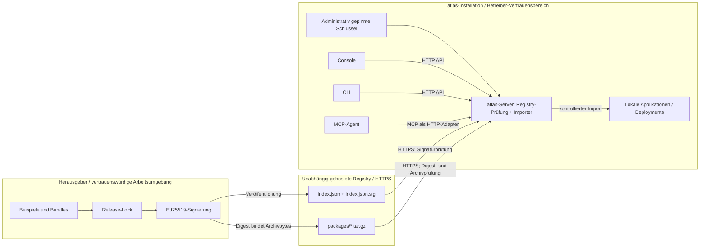
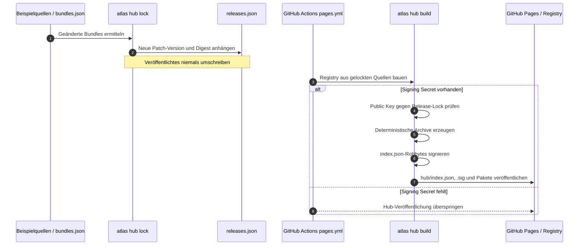
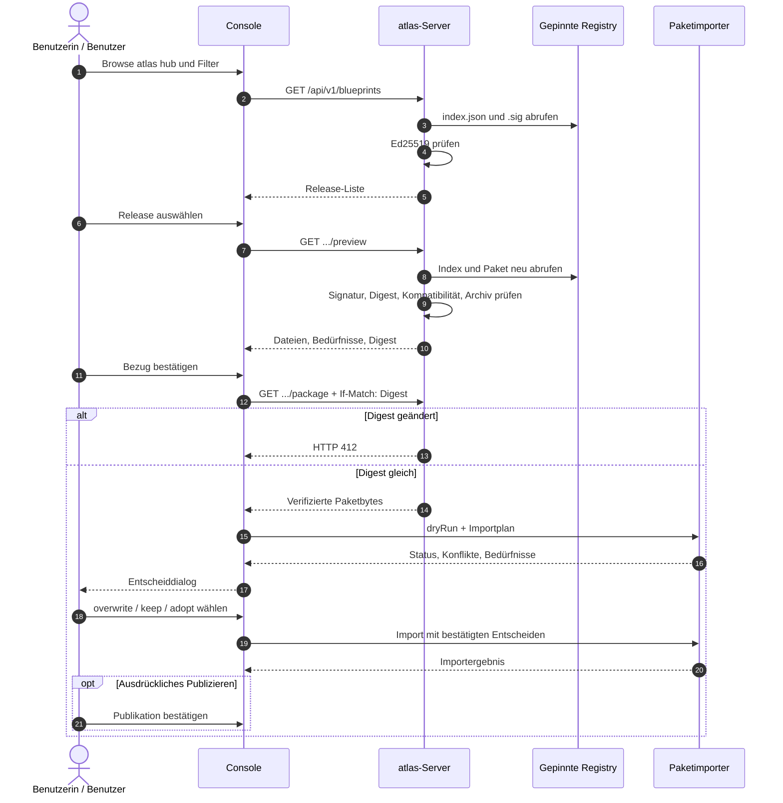
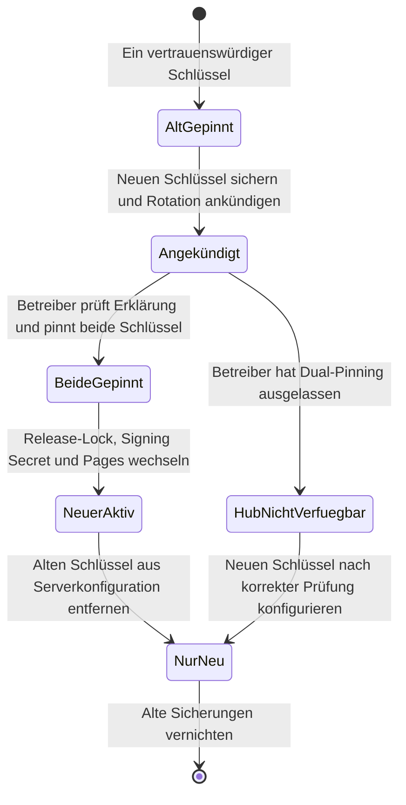

# atlas hub – signierte Verteilung von Prozessapplikationen

**Technisches Whitepaper · Architektur, Sicherheitsmodell und Betrieb**  
**Stand der Faktenbasis:** 6. November 2026  
**Einordnung:** Beschreibung des implementierten Registry-Vertrags v1 und der ausdrücklich offenen Folgeschritte. Kein Nachweis einer vollständigen Produkt- oder Betriebsfreigabe.

> **Leseschlüssel:** **Umgesetzt** bezeichnet ein in der bereitgestellten Faktenbasis als vorhanden beschriebenes Verhalten. **Teilweise umgesetzt** bezeichnet einen übergreifenden Entscheid, dessen Gesamtumfang noch nicht abgeschlossen ist. **Geplant/offen** bezeichnet Funktionen oder Nachweise, die gerade nicht als verfügbar gelten dürfen. **Einschätzung** kennzeichnet eine analytische Schlussfolgerung aus den genannten Fakten.

## Inhaltsverzeichnis

1. [Management Summary](#1-management-summary)
2. [Ausgangslage und Problem](#2-ausgangslage-und-problem)
3. [Begriffe und Abgrenzung](#3-begriffe-und-abgrenzung)
4. [Architekturüberblick](#4-architekturüberblick)
5. [Der Registry-Vertrag v1](#5-der-registry-vertrag-v1)
6. [Kryptografie und Vertrauensmodell](#6-kryptografie-und-vertrauensmodell)
7. [Netzwerk- und Archivsicherheit](#7-netzwerk--und-archivsicherheit)
8. [Veröffentlichen: Herausgeberseite](#8-veröffentlichen-herausgeberseite)
9. [Importieren: Installationsseite](#9-importieren-installationsseite)
10. [Konfliktfälle im Detail](#10-konfliktfälle-im-detail)
11. [Agenten und Automatisierung](#11-agenten-und-automatisierung)
12. [Betrieb und Schlüsselrotation](#12-betrieb-und-schlüsselrotation)
13. [Bedrohungsmodell](#13-bedrohungsmodell)
14. [Offene Punkte, Grenzen und Ausblick](#14-offene-punkte-grenzen-und-ausblick)
15. [Glossar und ADR-Verzeichnis](#15-glossar-und-adr-verzeichnis)

---

## 1. Management Summary

Die Wiederverwendung fachlicher Prozessapplikationen setzt mehr voraus als das Kopieren von BPMN-Dateien. Ein verteiltes Paket muss einer nachvollziehbaren Veröffentlichung zugeordnet, gegen Manipulation geprüft und in eine bestehende Installation importiert werden können, ohne deren lokale Arbeit oder produktive Prozessausführungen stillschweigend zu verändern. **atlas hub** verbindet dazu einen signierten, statisch über HTTPS ausgelieferten Katalog mit dem bestehenden Import von Applikationspaketen in atlas.

Der technische Vertrag heisst weiterhin **Blueprint Registry v1**. Ein Registry-Betreiber veröffentlicht einen `index.json`, dessen exakte Bytes mit Ed25519 signiert werden; jedes dort gelistete Paket ist zusätzlich über den SHA-256-Digest seiner komprimierten Archivbytes gebunden. Eine Installation akzeptiert nur einen Index, der zu einem vom Betreiber ausserhalb der Registry bezogenen und gepinnten öffentlichen Schlüssel passt. Der Schlüssel begründet das Vertrauen in die Quelle, nicht in die Unbedenklichkeit der Inhalte.

Der Import erfolgt kontrolliert: Vorschau und Probelauf zeigen Dateien, Abhängigkeiten und Konflikte; Entscheidungen zu lokalen oder fremden Artefakten werden explizit getroffen; der eigentliche Paketimport verwendet den bestehenden Mechanismus nach ADR-0467. Das Publizieren der importierten Applikation ist ein eigener Schritt. Ein Blueprint-Update migriert keine laufenden Instanzen. Bereits deployte Applikationen bleiben von einer nicht erreichbaren oder deaktivierten Registry unabhängig.

Die vorliegenden Angaben weisen den **Registry-Vertrag, die Signaturprüfung, Schutzgrenzen, die Veröffentlichung der Beispiele, Console-Abläufe, CLI und MCP-Anbindung sowie konfliktbewusste Importregeln als umgesetzt** aus. Der Grundsatzentscheid ADR-0499 ist dagegen **Accepted / Partial**; der Programmschritt BMP1 ist aktiv. Dauerhafte Installations-Provenienz, historische Paketversionen, verwaltete Updates, mehrere Quellen und kommerzielle Auslieferungsmodelle sind offen beziehungsweise geplant. Das Whitepaper ist daher keine Aussage, dass der gesamte Lebenszyklus bereits abgeschlossen ist.

**Einschätzung:** Die wesentliche architektonische Stärke liegt in der Trennung der Vertrauensprüfung, der fachlichen Importentscheidung und der eigentlichen Prozessausführung. Der wesentliche noch offene Nachweis betrifft die dauerhaft nachvollziehbare Beziehung zwischen importiertem Release und lokalem Installationszustand, insbesondere über Neustart und Teilfehler hinweg.

## 2. Ausgangslage und Problem

### 2.1 Ein Beispiel ist mehr als eine Datei

Eine atlas-Prozessapplikation bündelt Prozesse in BPMN, Formulare, Entscheidungen und referenzierte Entscheidungsmodelle. Sie besitzt einen portablen Applikationsschlüssel sowie eigene Releases und Deployments. Dieselbe technische Quelle kann als Handbuchbeispiel dienen oder als Ausgangspunkt einer lokalen Fachapplikation verwendet werden. In beiden Fällen entsteht nach dem Import ein eigenständig verwalteter lokaler Zustand.

Das reine Kopieren einzelner Quelldateien beantwortet mehrere betriebliche Fragen nicht. Die Installation weiss damit nicht zwangsläufig, ob alle zusammengehörigen Artefakte übertragen wurden. Ein Name oder eine Version allein belegt nicht, welche Bytes bezogen wurden. Ohne Importvergleich lässt sich schwer unterscheiden, ob eine Datei seit dem letzten Import lokal bearbeitet wurde, ob sie vom Herausgeber verändert wurde oder ob beide Seiten voneinander abweichen. Besonders kritisch sind Artefakte, die bereits einer anderen Applikation zugeordnet sind, und Entscheidungsmodelle, auf die weitere Applikationen verweisen.

Das Problem betrifft nicht allein Softwarelieferanten. Für die Betreiberseite stellen sich Fragen nach Herkunft, Kontrolle der ausgehenden Verbindungen, Berechtigungen, Wiederholbarkeit und Folgen eines Ausfalls der Veröffentlichungsinfrastruktur. Die Entwicklungsseite muss wiederum Releases so erzeugen, dass eine bereits veröffentlichte Versionsnummer nicht nachträglich einen anderen Inhalt bezeichnet.

### 2.2 Vier notwendige Eigenschaften

**Integrität** bedeutet hier, dass ein Index und die referenzierten Archivbytes beim Bezug anhand kryptografischer Werte überprüft werden. **Herkunft** bedeutet, dass die akzeptierte Veröffentlichung zu einem Schlüssel gehört, den der Betreiber bewusst als vertrauenswürdig gepinnt hat. Diese Herkunftsaussage ist begrenzt: Die DNS-artige Schreibweise einer Herausgeberkennung belegt nicht von sich aus deren Eigentümer.

**Wiederholbarkeit** verlangt deterministische Paketbytes und einen Release-Lock, der die Zuordnung einer Version zu einem Digest dauerhaft festhält. **Schutz lokaler Änderungen** verlangt dagegen keinen starren Importstopp für jede Abweichung, sondern einen Plan, der automatische, unkritische Fälle von ausdrücklich entscheidungspflichtigen Fällen unterscheidet. Die Import-Baseline dient als dritter Vergleichspunkt zwischen Paket und aktuellem Serverstand.

Die vier Eigenschaften sind voneinander zu trennen. Ein korrekt signiertes Paket darf technisch unverändert angekommen sein und trotzdem Modelle enthalten, die der Betreiber nicht publizieren will. Ein lokaler Import kann vollständig berechtigt sein und trotzdem bewusst ein Modell ersetzen, das von mehreren Applikationen verwendet wird. Die Herkunftsprüfung ersetzt also weder die fachliche Kontrolle noch die Rechteprüfung.

### 2.3 Anforderungen an eine entkoppelte Plattform

atlas wird als einzelnes Go-Binary betrieben; die Workflow-Engine kompiliert BPMN-Modelle und arbeitet mit persistierten Ereignissen. Für das Hub-Verteilmodell wurde entschieden, den öffentlichen Vertrag und den Registry-Client in das öffentliche atlas-Repository aufzunehmen, während Registries unabhängig gehostet werden. Damit wird die Verteilung nicht an eine bestimmte kommerzielle Plattform oder an das Klonen von Git-Repositories gebunden.

Für den Betrieb ist besonders relevant, dass kein Lizenzserver im Ausführungspfad vorgesehen ist. Ein gekaufter Inhalt darf nach dem Import offline weiterlaufen. Ebenso unterbricht die fehlende Erreichbarkeit einer Registry bereits deployte Prozesse nicht. Eine Entfernung der Registry gilt nicht als nachträglicher Laufzeit-Lizenzwiderruf.

### 2.4 Bewusst verworfene Vereinfachungen

ADR-0499 verwirft drei grundlegende Alternativen: einen Katalog einschliesslich Kasse und Lizenzlogik direkt in atlas, ausschliessliche Distribution über GitHub-Klone und einen fest in das Binary eingebauten Katalog. Alle drei Alternativen würden andere Kopplungen erzeugen als die gewählte Kombination eines offenen Clients und unabhängig betreibbarer, statischer Registries.

**Einschätzung:** Die technische Abgrenzung ist wichtiger als die konkrete Hosting-Plattform. Ein eigenständiger HTTPS-Host kann den Vertrag erfüllen, ohne GitHub zu benötigen. Gleichzeitig bleibt die Entscheidungsverantwortung für die vertrauenswürdige Quelle bei der jeweiligen Installation.

## 3. Begriffe und Abgrenzung

### 3.1 atlas hub als Produktbegriff

**atlas hub** ist seit dem 28. Oktober 2026 der Produktname für das Finden, Verteilen und den Lebenszyklus wiederverwendbarer atlas-Inhalte. Der technische Schnittstellenname bleibt **Blueprint Registry v1**. Deshalb enthalten API-Routen und Umgebungsvariablen weiterhin das Wort `blueprint`: beispielsweise `blueprintId`, `/api/v1/blueprints` und `ATLAS_BLUEPRINT_REGISTRY_*`. Diese Koexistenz ist beabsichtigt und dient der Kompatibilität. Ein Produktbegriff ist nicht ohne Weiteres ein API-Migrationsauftrag.

Eine **Registry** bezeichnet die Quelle des signierten Index und der zugehörigen Archive. Der Vertrag spezifiziert statische HTTPS-Dateien; auf der Serverseite verifiziert der atlas-Client die empfangenen Daten. **Publisher** oder Herausgeber bezeichnet die im Release genannte Herausgeberidentität. Eine **Prozessapplikation** ist dagegen das lokale fachliche Aggregat, in das Artefakte importiert und später publiziert werden können.

### 3.2 Blueprint-Release und Applikationspaket

Ein **Blueprint-Release** ist eine unveränderliche, versionierte Verteilhülle um das bereits vorhandene **Applikationspaket** nach ADR-0467. Für atlas hub wird kein neues Paketformat eingeführt. Der Registry-Eintrag ergänzt Informationen wie Herausgeber, Identität, Version, Kompatibilitätsbereich und Digest. Das eigentliche Paket verwendet unverändert den Importpfad, der auch für hochgeladene Applikationspakete existiert.

Diese Trennung schützt die Austauschbarkeit. Der Registry-Vertrag kann Herkunft und Auswahl eines Pakets regeln, ohne den fachlichen Import der darin enthaltenen Modelle neu zu erfinden. Der Import wiederum kann unabhängig davon beurteilen, ob eine lokale Datei ersetzt, behalten oder aus einer anderen Applikation übernommen werden darf.

### 3.3 Identität ist mehrschichtig

Die Identität eines Releases besteht aus dem Vertrauen in den Signierschlüssel der Registry sowie aus `publisherId`, `blueprintId`, `version` und `digest`. Die installierte Prozessapplikation besitzt einen davon getrennten Schlüssel und danach ihre eigenen lokalen Änderungen, Releases und Deployments. Ein identischer Registry-Digest bedeutet deshalb nicht automatisch, dass die lokale Applikation unverändert ist.

Im MVP kann ein Blueprint auf einem Server nur einmal und mit seinem Applikationsschlüssel installiert werden. Mehrere unabhängige Kopien desselben Blueprints würden eine zusätzliche Entscheidung über das Umbenennen von Prozess-, DMN-, Formular- und Katalog-IDs verlangen. Die Herkunftsidentität wird also nicht als Mechanismus für beliebig viele lokale Klone interpretiert.

### 3.4 Bundle und Release-Lock

Ein **Bundle** bündelt mehrere Beispielquellen zu einer installierbaren Applikation. Der Zweck ist nicht, möglichst viele technische Einträge zu erzeugen, sondern thematisch zusammengehörige Beispiele als Einheit bereitzustellen. Für Bundles gelten überprüfte Regeln zur eindeutigen Zuordnung von Beispielen und IDs.

Der **Release-Lock** ist die append-only geführte Liste veröffentlichter Bundle-Versionen mit ihren Digests und der Mindestversion von atlas. Er bildet die Regel ab, dass eine einmal verwendete Version nicht später einen abweichenden Archivinhalt bezeichnen darf. Die Dateien `examples/hub/bundles.json` und `examples/hub/releases.json` erfüllen damit unterschiedliche Aufgaben: Paketbildung und unveränderliche Release-Zuordnung.

## 4. Architekturüberblick

### 4.1 Komponenten und Zuständigkeiten

Die Herausgeberseite erzeugt aus den festgelegten Beispielen deterministische Applikationsarchive und einen signierten Index. Die Registry liefert diese Dateien statisch über HTTPS aus. Der atlas-Server hat einen administrativ konfigurierten Registry-Endpunkt und einen oder zwei gepinnte öffentliche Schlüssel. Er holt Dateien, validiert ihre Signatur, ihren Digest und weitere Schutzbedingungen und stellt die Ergebnisse über HTTP-Routen bereit.

Die Console nutzt diese Routen zur Auswahl und Vorschau und führt den interaktiven Paketimport. Die CLI kann einen Importplan darstellen und Entscheide entgegennehmen. Ein MCP-Agent erhält für atlas hub eng definierte Werkzeuge, die über die öffentliche HTTP-API führen und keine eigene Vertrauensquelle konfigurieren. In allen Fällen bleiben die eigentlichen Engine-Aktivitäten von der Netzwerk- und Archivvalidierung getrennt.

### 4.2 Komponenten und Vertrauensgrenzen

**Vertrauensgrenze A – Herausgeber zu Registry:** Die auf dem Host ausgelieferten Bytes sind nicht allein deshalb vertrauenswürdig, weil die Verbindung TLS nutzt. Die Installation prüft die Ed25519-Signatur der Index-Rohbytes und danach den im signierten Index gebundenen Paket-Digest.

**Vertrauensgrenze B – Registry zu Installation:** Nur eine vom Administrator festgelegte Adresse ist erlaubt. Es gibt keine frei eingebbare URL im Hub-Dialog. Die Netzregeln schliessen unter anderem Redirects, private Zieladressen und andere Ports als 443 aus.

**Vertrauensgrenze C – Auswahl zu lokaler Änderung:** Ein verifiziertes Archiv ist noch kein autorisierter Schreibauftrag. Paketvorschau und Probelauf werden von einem entscheidungspflichtigen Import mit Rollen- und Artefaktkontrolle unterschieden.

### 4.3 Warum die Engine ausserhalb bleibt

Alle Netzwerk- und Validierungsschritte laufen ausserhalb der Engine-Run-Loop. Write-Ahead-Log, die deterministische Zustandsfunktion `applyToState` und die Ausführungsschleife bleiben von der Registry-Integration unberührt. Der Registry-Ausfall ist damit kein Grund, bereits deployte Applikationen anzuhalten. Das ist eine funktionale Grenze und zugleich eine Sicherheitsgrenze: Die Hub-Prüfung darf nicht als neue Laufzeit-Abhängigkeit interpretiert werden.

Ein Import kann Quellartefakte bereitstellen; die tatsächliche Publikation geschieht ausdrücklich später. Ein Blueprint-Update migriert niemals laufende Prozessinstanzen. Wenn ein Update scheitert, bleiben bestehende Deployments unverändert. Diese beiden Regeln verhindern, dass die Herkunfts- und Distributionslogik unbemerkt in die Semantik bereits laufender Prozesse eingreift.

### 4.4 Implementierter und zukünftiger Rahmen

**Umgesetzt:** eine Registry pro Server, statische Dateien und die beschriebenen HTTP-Routen, rollenbasierte Nutzung, Signatur- und Archivprüfung sowie Importplanung. **Teilweise umgesetzt:** der umfassende Lebenszyklus aus ADR-0499. **Geplant/offen:** mehrere Registries, private und authentifizierte Quellen, ältere abrufbare Release-Artefakte und dauerhaft gespeicherte Installations-Provenienz. Eine Architekturzeichnung darf diese Schichten nicht zu einer bereits vollständigen Föderation zusammenziehen.

## 5. Der Registry-Vertrag v1

### 5.1 Auslieferbare Dateien

Eine Registry stellt `index.json`, `index.json.sig` und die unter `packages/` liegenden `tar.gz`-Archive als statische HTTPS-Dateien bereit. Die Beispiel-Registry ist unter `https://pblumer.github.io/atlas/hub/index.json` erreichbar. Das Hosting auf GitHub Pages ist ein konkretes Beispiel, keine Voraussetzung des Protokolls. Ein anderer HTTPS-Server kann dieselbe Dateistruktur bedienen.

Die Artefaktpfade sind relativ zum Verzeichnis des Index aufzulösen. Sie dürfen keine absoluten URLs, keine Traversal-Segmente und keine Prozent-Escapes enthalten. Der Bezug bleibt am selben HTTPS-Ursprung. Damit beschreibt der signierte Index keinen allgemeinen Web-Crawler, sondern eine kontrollierte, enge Liste von Archivpfaden.

### 5.2 Indexstruktur und Release-Metadaten

Die Wurzel von `index.json` enthält `schemaVersion`, `registryId` und `releases`. Ein Release führt `blueprintId`, `version`, `publisherId`, `title`, `description`, `license`, den Block `atlas`, das Objekt `artifact`, das Objekt `needs` und optional `tags`. Die Version verwendet SemVer. `atlas.minVersion` ist inklusiv, `atlas.maxVersionExclusive` – falls gesetzt – exklusiv. Die Kombination aus `blueprintId` und `version` ist innerhalb eines Index eindeutig.

Das `artifact`-Objekt enthält einen relativen `path`, einen `digest` der Form `sha256:` gefolgt von 64 Hex-Zeichen sowie `sizeBytes`. Die Digest-Berechnung bezieht sich auf das tatsächlich verteilte komprimierte Archiv, nicht auf eine hypothetische normalisierte Beschreibung seiner Inhalte. Die Grösseninformation ist eine weitere Eingabe für die Kontrolle der bezogenen Datei.

Die `needs`-Angaben nennen `workerTypes` und `serverConstants`. Sie beschreiben Bedürfnisse der Veröffentlichung, sind aber keine Garantie, dass alles zur Ausführung Benötigte schon vorhanden ist. Der tatsächliche Import ermittelt die Bedürfnisse anhand der im Paket enthaltenen Modelle. Die Ausgabe der Registry darf deshalb nicht als vollständiger Ersatz einer Importvorschau betrachtet werden.

### 5.3 Strikte Validierung

`blueprintId` muss mit `publisherId` gefolgt von einem Punkt beginnen. Doppelte Objekt-Schlüssel, unbekannte JSON-Felder und nicht unterstützte Hauptversionen werden zurückgewiesen. Ein leerer oder umgekehrter atlas-Kompatibilitätsbereich ist ungültig. Wenn ein Release nicht zur aktuellen Installation passt, erfolgt kein stilles Ausweichen auf ein anderes Release. Das ablehnende Verhalten gilt auch für nicht unterstützte Erweiterungen.

Diese Regeln sind als **fail closed** zu verstehen: Bei nicht eindeutig interpretierbaren oder unbekannten Eingaben wird nicht stillschweigend ein kleinerer, vermeintlich kompatibler Teil akzeptiert. Dies verhindert insbesondere, dass eine erweiterte Veröffentlichung auf einem älteren Client anders verstanden wird als auf einem neueren.

### 5.4 Tags sind nur Darstellungsmetadaten

Der Nachtrag vom 2. November 2026 erlaubt pro Release bis zu 16 eindeutige Kleinbuchstaben-Labels mit 1 bis 32 Zeichen. Zulässig sind Kleinbuchstaben und Ziffern; Bindestriche dürfen nur innerhalb eines Tags stehen. Diese Labels sind Teil des signierten Index und dienen in der Console als Filter. Sie sind weder Berechtigungen noch eine beweiskräftige Beschreibung des Paketverhaltens.

Ein älterer Server, dessen Vertrag `tags` noch nicht kennt, weist einen solchen Index wegen des unbekannten Feldes zurück. Der Nachtrag verbessert damit die Auffindbarkeit, ohne auf älteren Installationen eine neue Bedeutung in einen unverstandenen Vertrag hineinzudeuten.

### 5.5 Beispiel-Identitäten

Die Beispiel-Registry verwendet `registryId` `io.github.pblumer.atlas.hub`, die Herausgeberkennung `io.github.pblumer.atlas` und die Lizenz `AGPL-3.0-only` für ihre Beispiele. Diese Bezeichner stellen eine konkrete Katalogidentität dar. Die semantische Behauptung, dass ein Herausgeber bekannt ist, folgt jedoch aus der Bestätigung durch den Registry-Betreiber und nicht aus einer kryptografischen Ableitung aus der Zeichenfolge.

**Einschätzung:** Der Vertrag legt die technischen Prüfpunkte bewusst eng fest. Zusätzliche Metadaten sollten nicht ungeprüft als unverbindliche Dekoration behandelt werden: Das Ablehnen unbekannter Felder ist eine Funktion des Sicherheits- und Kompatibilitätsmodells.

## 6. Kryptografie und Vertrauensmodell

### 6.1 Was signiert wird

Der Registry-Betreiber signiert die **exakten Bytes** der Datei `index.json` mit Ed25519. Die Datei `index.json.sig` enthält die Base64-Kodierung nach RFC 4648 ohne Zeilenumbruch einer Ed25519-Signatur von 64 Bytes. Bei der Verifikation werden die empfangenen JSON-Bytes nicht neu serialisiert, umsortiert oder auf andere Weise kanonisiert. Die Signatur bezieht sich auf die ausgelieferte Bytefolge, nicht auf einen daraus rekonstruierten abstrakten JSON-Baum.

Jeder Release-Eintrag bindet sein Archiv über den SHA-256-Digest der **komprimierten Archivbytes**. Der Client muss daher zwei Ebenen prüfen: erstens den signierten Katalog, zweitens den Digest des bezogenen Pakets. Der signierte Index enthält die zu erwartende Länge und den Digest; die Archivprüfung befasst sich anschliessend mit Pfaden, Typen, Grössen und der Integrität der komprimierten Struktur.

Eine gültige Signatur sagt präzise: Der Index wurde mit dem privaten Gegenstück eines gepinnten öffentlichen Schlüssels signiert. Ein passender Paket-Digest sagt: Die empfangenen komprimierten Bytes sind diejenigen, auf die dieser signierte Index verweist. Beides sagt **nicht**, dass ein Prozess, ein Skript, ein referenzierter Worker Type oder eine spätere Ausführung harmlos ist.

### 6.2 Betreiberseitiges Vertrauen statt automatischer Selbstbestätigung

Der öffentliche Schlüssel wird ausserhalb der Registry beschafft und in der Serverkonfiguration festgelegt. Ein aus dem Index, einer Webseite oder einem anderen heruntergeladenen Paket entnommener Schlüssel wird niemals schon deshalb akzeptiert, weil er bei derselben Quelle liegt. Das Modell vermeidet **Trust-on-first-use**: Die erste Verbindung ist nicht automatisch vertrauenswürdig. Ein unsignierter oder ungültig signierter Index wird abgewiesen, nicht in einem Modus «unverifiziert» angezeigt.

Dies ist organisatorisch bedeutsam. Der Betreiber entscheidet bewusst, welcher Herausgabestelle er vertraut. Die kryptografische Prüfung stellt danach sicher, dass der Host diese Entscheidung nicht durch einen ausgetauschten Index unbemerkt umgehen kann. Wird der private Schlüssel kompromittiert, ist jedoch genau diese Grundlage betroffen. Der Schlüssel selbst benötigt deshalb eine gesonderte Herstellungs-, Sicherungs-, Rotations- und Notfallpraxis.

### 6.3 Abgewogene Sicherheitsalternativen

**Nur HTTPS statt gepinnter Signatur:** TLS ist erforderlich, ersetzt aber nicht die Festlegung der Herausgabestelle über mögliche Spiegel hinweg. Der gepinnte Schlüssel macht die Akzeptanz nicht allein von der aktuell verwendeten Hosting-Adresse abhängig. Der Preis ist ein administrativer Schlüsselbestand, der initial verteilt und später rotiert werden muss.

**Kanonisches JSON statt signierter Rohbytes:** Ein sprachübergreifend korrekt implementiertes Kanonisierungsschema könnte semantisch äquivalente JSON-Dokumente auf gleiche Bytes abbilden. Gewählt wurde stattdessen die unmittelbar überprüfbare Bytefolge. Jede Umformatierung des Index erfordert damit eine neue Signatur. Das ist ausdrücklich akzeptiert und vereinfacht die Definition des signierten Gegenstands.

**Einzeln signierte Pakete statt signiertem Index:** Herausgeberbezogene Paketsignaturen wurden zurückgestellt. Sie würden ein geklärtes Modell für die Identität und den Widerruf einzelner Herausgeber benötigen. Im aktuellen Vertrag trägt die Registry als gepinnte Vertrauensquelle die Veröffentlichung; sie bindet ihre Pakete über Digests.

**Beliebige CDN-Adressen statt gleicher Ursprung:** Fremde Paketadressen könnten zusätzliche Auslieferungsmodelle erleichtern. Sie würden jedoch eine breitere Fläche für Server-Side Request Forgery (SSRF) und die Weiterleitung von Zugangsinformationen eröffnen. Der Vertrag beschränkt Pakete deshalb auf relative Pfade am gleichen HTTPS-Ursprung.

### 6.4 Grenzen der behauptbaren Sicherheit

Die Signatur bewirkt keine automatische inhaltliche Freigabe. Ein importierter BPMN-Prozess kann Worker Types verlangen, die in einer Zielinstallation nicht eingerichtet sind. Er kann modellierte Abläufe enthalten, die dort fachlich nicht akzeptiert werden. Worker Types können ihrerseits eigene Integrationsrechte benötigen. Das Paket bringt keine Credentials und keine installationsspezifischen Geheimnisse mit.

Die geltenden Prüf- und Deploy-Regeln bleiben deshalb bestehen. Insbesondere ist eine Importvorschau keine Publikation. Der Server darf die unveränderte Herkunft nicht mit einer Autorisierung zur Ausführung verwechseln. Der Download eines Worker Types lädt ausserdem keinen beliebigen ausführbaren Code direkt in den atlas-Server; hierzu bleibt die Grenze von ADR-0208 relevant.

## 7. Netzwerk- und Archivsicherheit

### 7.1 Eine administrative, feste Quelle

Die Registry wird vor dem Serverstart über `ATLAS_BLUEPRINT_REGISTRY_URL` und `ATLAS_BLUEPRINT_REGISTRY_KEY` konfiguriert. Die Schlüsselvariable enthält einen oder zwei durch Komma getrennte öffentliche Ed25519-Schlüssel, jeweils als Base64 der 32 Schlüsselbytes. Sind beide Variablen nicht gesetzt, ist die Hub-Funktion deaktiviert. Eine unvollständige oder ungültige Konfiguration verhindert den Serverstart.

Normale Hub-Benutzende können keine beliebige Registry-URL in ein Formular eingeben. Dieser Verzicht ist eine ausdrückliche Schutzmassnahme. Würde ein Server auf Anforderung seiner Benutzer beliebige Adressen abrufen, müsste er weit mehr potenzielle Ziele und Weiterleitungen sicher beherrschen. Stattdessen wählt ein privilegierter Administrator die eine zulässige Quelle.

### 7.2 DNS-, IP- und Redirect-Prüfung

Verbindungen sind auf HTTPS, öffentliche DNS-Hosts und Port 443 beschränkt. Redirects sind vollständig deaktiviert. Eine DNS-Antwort darf weder leer sein noch mehr als 16 Adressen enthalten. Sobald eine Adresse als nicht öffentlich klassifiziert wird, wird die Verbindung verweigert. Dies umfasst private, Loopback-, Link-Local-, unspezifizierte und reservierte Bereiche einschliesslich Dokumentations-, Benchmark- und Carrier-Grade-NAT-Adressräumen sowie entsprechender IPv6-Präfixe.

Damit adressiert das Modell zwei typische Klassen von Missbrauch: SSRF, bei dem ein Server gegen interne Dienste eingesetzt würde, und DNS-Rebinding, bei dem eine zuvor unauffällige Adresse auf eine unzulässige Zieladresse umgebogen wird. Die konkret implementierten Netzwerkregeln begrenzen die erlaubte Hostklasse und den Zielport; die relative Pfadauflösung verhindert zudem den Wechsel auf einen anderen Ursprung.

### 7.3 Verbindliche Grenzwerte

| Prüfgegenstand | Grenze / Regel | Bedeutung |
|---|---:|---|
| Verbindungsaufbau | 5 Sekunden | Begrenzung der Aufbauphase |
| Gesamte HTTPS-Anfrage | 25 Sekunden | Begrenzung der Anfragezeit |
| Zielport | 443 | Kein Abruf über andere Ports |
| DNS-Antwort | 1–16 Adressen | Leere oder zu grosse Antwort wird abgewiesen |
| Signierter Index | höchstens 1 MiB | Begrenzte Indexbytes |
| Releases pro Index | höchstens 512 | Begrenzte Kataloggrösse |
| Signaturdatei | höchstens 88 Bytes | Begrenzte Base64-Signaturdatei |
| Komprimiertes Paket | höchstens 50 MiB | Begrenzter Download |
| Entpackter Archivinhalt | höchstens 200 MiB | Schutz vor Ausdehnung beim Entpacken |
| Archiveinträge | höchstens 2000 | Begrenzung der Eintragsanzahl |
| Manifest | höchstens 2 MiB | Begrenzung der Metadaten |
| Katalogdokument | höchstens 16 MiB | Begrenzung eines Katalogdokuments |

Die Grenzwerte sind Eigenschaften des in der Faktenbasis beschriebenen Registry-Clients und Paketpfads. Sie sind keine Leistungskennzahlen, keine Angaben zur Anzahl laufender Prozesse und keine Aussagen über die maximal mögliche Grösse einer lokalen atlas-Installation.

### 7.4 Archivprüfung ohne implizites Vertrauen

Die Registry liefert Archive im Format `tar.gz`. Der Prüfer kontrolliert Pfade, Archiveintragstypen, Grössen und GZIP-Integrität, ohne den geprüften Inhalt auf die Festplatte zu schreiben. Weder symbolische Links noch Tar-Header werden implizit als zulässige Dateisystemoperationen übernommen. Damit wird der Prüfpfad nicht zu einem Entpacker, der ungeprüft Verzeichnisse überschreiben könnte.

Die Begrenzung sowohl der komprimierten als auch der entpackten Menge ist notwendig, weil ein kleines Archiv in seiner entpackten Form wesentlich grösser sein kann. Die Eintragszahl adressiert einen anderen Ressourcenverbrauch als die reine Bytezahl. Die Pfad- und Typprüfung begegnet zudem dem Versuch, durch Archivnamen oder spezielle Einträge ausserhalb des vorgesehenen Zielbereichs zu wirken.

### 7.5 Ausfall und Abgrenzung

Bei nicht erreichbarer Registry steht der Hub-Bezug nicht zur Verfügung. Bereits importierte und deployte Applikationen laufen weiter. Weder die Run-Loop noch das WAL oder `applyToState` sind Teil dieses externen Abrufs. Der Wegfall einer Registry ist damit eine Störung der Distribution, nicht automatisch eine Störung der Ausführung.

**Einschätzung:** Diese Trennung erleichtert eine konservative Betriebsentscheidung: Bei Zweifel an Quelle, Schlüssel oder Netzwerkzustand kann der Hub deaktiviert werden, ohne dass damit zugleich die bestehenden Workflows abgeschaltet werden müssen. Sie entbindet allerdings nicht von einer Untersuchung bereits importierter Inhalte, falls eine Kompromittierung vermutet wird.

## 8. Veröffentlichen: Herausgeberseite

### 8.1 Zusammenstellung der Beispiel-Bundles

Die Datei `examples/hub/bundles.json` fasst Handbuch- und Fachbeispiele nach Thema zusammen. Beschrieben sind derzeit 14 Bundles: fünf Themen-Bundles («Beispiele: Einstieg», «Auftrag & Finanzen», «Personal & Mitarbeitende», «Umsysteme» sowie «Identität & Verzeichnis»), drei Leitbeispiele aus dem Handbuch, das Einzelbeispiel «Beispiel: Multi-Instance» und fünf Shop-Pakete mit Produktkatalogen. Die Leitbeispiele betreffen Bewerbermanagement, Lehrgang Mitarbeitereintritt und ein Onboarding-Tutorial. Die Shop-Pakete umfassen Dienstleistungen der Verwaltung, Microsoft-365-Dienste, Active-Directory-Dienste, Lizenzmanagement und Informationstransfer.

Die Bündelung vermeidet, dass jede kleine Demonstration eine eigenständige lokale Applikation erzeugt. Zugleich besteht eine eindeutige fachliche Zuordnung: Jedes installierbare Handbuchbeispiel gehört genau einem Bundle an. Bundles mit mehreren Beispielen benötigen einen Namen, aus dem sich der portable Applikationsschlüssel ableiten lässt. Ein Shop-Paket reist allein. Innerhalb eines Bundles müssen die IDs für Prozesse, Formulare und Entscheidungen jeweils eindeutig sein. Diese Regeln sind durch Tests abgesichert.

Tags entstehen beim Build aus den verwendeten Worker Types. Für jeden verwendeten Worker Type kann ein passender Tag ergänzt werden, beispielsweise `entra` oder `jira`. Pakete mit Katalog erhalten `shop`. Die Tags verbessern die Suche, machen jedoch keine Aussage über Vollständigkeit von Abhängigkeiten oder Berechtigungen.

### 8.2 Reproduzierbare Paketbytes

Die Build-Regeln erzeugen deterministische Archive: USTAR-Einträge werden sortiert, Zeitstempel und Dateimodi sind festgelegt. Dieselben Quellen ergeben dadurch byte-identische Archive und denselben SHA-256-Digest. Diese Reproduzierbarkeit ist entscheidend, weil der Release-Lock nicht bloss eine Versionsnummer, sondern eine konkrete Byteidentität festhält.

Der Release-Lock in `examples/hub/releases.json` enthält Registry- und Herausgeberidentität, Lizenz, öffentlichen Schlüssel sowie für jedes Bundle alle jemals veröffentlichten Kombinationen aus Version, Digest und `minAtlas`. Einträge werden angehängt und nicht nachträglich umgeschrieben. Ein Test schlägt fehl, wenn der aktuelle Bundle-Inhalt nicht mehr zur zuletzt erfassten Version passt. `atlas hub lock` hängt bei Änderungen die nächste Patch-Version an.

Mit dem Release-Lock wird eine zeitliche Aussage möglich: Eine einmal veröffentlichte Version darf nachträglich nicht andere Bytes bezeichnen. Diese Aussage ist stärker als die Konvention, bei einem Dateinamen nur die Versionszahl zu erhöhen; sie wird gegen die Quellen und das deterministische Archiv überprüft.

### 8.3 Veröffentlichungsablauf

Der Workflow `pages.yml` erzeugt die Registry unter `hub/` der Pages-Site, sofern das Repository-Secret `ATLAS_HUB_SIGNING_KEY` vorhanden ist. Fehlt es, wird dieser Schritt übersprungen. `atlas hub build` akzeptiert keinen Signierschlüssel, dessen öffentliche Hälfte nicht mit dem im Release-Lock festgehaltenen `publicKey` übereinstimmt.

Der Workflow zur Nummerierung von ADR-Entwürfen kann Verweise in Beispieldateien ändern. Deshalb führt er `hub lock` mit aus. Der Zusammenhang ist wichtig: Auch eine nicht fachlich motivierte Änderung an einer Quelldatei kann die Archivbytes verändern und benötigt dann einen neuen gelockten Release.

### 8.4 Schlüsselherstellung und Sicherung

Die einmalige Schlüsselzeremonie findet auf einer vertrauenswürdigen Maschine statt. `atlas hub keygen` erzeugt einen privaten Schlüssel mit Dateimodus `0600`, überschreibt keine vorhandene Datei und gibt den öffentlichen Schlüssel sowie seinen Fingerprint aus. Es werden zwei Offline-Sicherungen an verschiedenen Orten angelegt. Beschrieben sind Papier und ein verschlüsseltes Medium oder Passwortmanager-Eintrag, jeweils bezeichnet mit Fingerprint, Datum und `registryId`. Die Passphrase wird nicht beim Medium aufbewahrt.

Die Sicherungen werden nach dem Erstellen und jährlich mit `atlas hub fingerprint` überprüft. Erst danach gehören der öffentliche Schlüssel in den Release-Lock und das Signiermaterial in das Repository-Secret; die Arbeitskopie des privaten Schlüssels wird gelöscht. Das GitHub-Secret ist nicht wieder auslesbar. Ohne funktionierende Sicherung würde sein Verlust eine Rotation mit Neukonfiguration sämtlicher Installationen erzwingen.

### 8.5 Einschränkung der Aufbewahrung

**Umgesetzt:** deterministischer Build, Release-Lock, Schlüsselprüfung und aktuelle Veröffentlichung. **Offen:** Die Registry hält gegenwärtig nur die jeweils neueste Version eines Bundles bereit. Frühere Archive werden nicht aufbewahrt. Damit können die historisch im Release-Lock bekannten Versionen nicht sämtlich erneut aus der Registry heruntergeladen werden. Die Aufbewahrung älterer Pakete und gepinnte Updates gehören zu BMP2.

**Einschätzung:** Der Release-Lock ist bereits ein Nachweis gegen das Umschreiben einer bekannten Versionsidentität. Er ersetzt jedoch keine tatsächlich abrufbare historische Artefaktablage und noch keine vollständige Wiederherstellungsstrategie.

## 9. Importieren: Installationsseite

### 9.1 Auswahl und Vorschau in der Console

Der Einstieg erfolgt in der Applikationsübersicht über «Create new → Browse atlas hub…». Der Benutzer kann Releases nach den signierten Tags filtern. Die Console ruft `GET /api/v1/blueprints` ab; der Server überprüft den Index vor jeder entsprechenden Antwort mit dem gepinnten Schlüssel.

Für ein gewähltes Release verwendet die Console `GET /api/v1/blueprints/{id}/releases/{version}/preview`. Der Server lädt den Index und das Paket erneut, prüft Signatur, Digest, atlas-Kompatibilität und Archiv und gibt eine Vorschau zurück. Angezeigt werden Applikationsname, Dateien, Kataloge und Produkte, deklarierte Bedürfnisse sowie der Digest. Dieser Schritt schreibt nichts in die Zielinstallation.

Nach der Bestätigung ruft die Console `GET …/package` mit dem zuvor geprüften Digest als `If-Match`-Bedingung auf. Falls inzwischen ein anderer Digest geliefert würde, antwortet der Server mit HTTP 412. Diese Bindung schliesst die Lücke zwischen der vom Menschen betrachteten Vorschau und den tatsächlich zur Übernahme vorgesehenen Bytes.

### 9.2 Probelauf, Entscheid und Publikation

Die verifizierten Archivbytes werden an denselben Paketimporter übergeben wie eine hochgeladene Datei nach ADR-0467. Der Paketimport beginnt mit einem Probelauf (`dryRun`) und einem Importplan. Die Console zeigt danach einen Entscheiddialog für Unterschiede, übernimmt gegebenenfalls Quellen und Konstanten und fragt bei Shop-Paketen zusätzlich nach Zielgruppen und Genehmigenden. Das Publizieren ist ausdrücklich eine separate Aktion. Kataloge können im interaktiven Console-Weg mit den nötigen installationsspezifischen Entscheidungen importiert werden.

### 9.3 Serverdirekter Import und Statuscodes

Neben dem Console-Weg existiert `POST /api/v1/blueprints/{id}/releases/{version}/import?digest=…`. Der Server holt das Release selbst aus der konfigurierten Registry, prüft es und verwendet denselben Importer und dieselben Rollenregeln wie `POST /api/v1/applications/source`. Fehlt der Digest im Request, antwortet er mit HTTP 428. Stimmt er nicht zum angebotenen Release, antwortet er mit HTTP 412. Offen gebliebene Konfliktentscheidungen führen zu HTTP 409 zusammen mit dem Plan und `undecided`.

Der serverdirekte Import nimmt Kataloge **nicht** automatisch mit. Stattdessen meldet er sie unter `cataloguesNotImported`. Der Grund liegt in den installationsspezifischen Fragen nach Gruppen und Personen; diese werden im Console-Weg von einer Person beantwortet. Ein erfolgreicher serverdirekter Quellenimport darf daher nicht als vollständig eingerichtetes Shop-Angebot ausgegeben werden.

### 9.4 Rollen und Änderungshoheit

Die Registry-Routen benötigen die Rolle `modeler`. Bei Import in eine bestehende Applikation ist das dortige Bearbeitungsrecht erforderlich. Ist der portable Schlüssel dem Server unbekannt, wird eine neue Applikation erstellt. Für den Katalogimport ist zusätzlich die Rolle `productmanager` vorgesehen. Bei Artefakten anderer Applikationen oder gemeinsam genutzten Modellen gelten weitere Rechteprüfungen, die in Kapitel 10 erläutert werden.

Die Autorisierung erfolgt also nicht nur auf Ebene «Darf ein Benutzer den Hub öffnen?». Die entscheidende Frage ist, welche konkreten lokalen Artefakte die beabsichtigte Änderung betrifft. Rollen für die Hub-Routen ersetzen keine Bearbeitungsrechte an einer betroffenen Applikation.

### 9.5 Import-Baseline und Planstatus

Der Importer vergleicht jedes Artefakt mit dem aktuellen Serverstand und der gespeicherten Baseline des letzten Imports. Dadurch ist eine einfache Unterscheidung zwischen «gleich», «nur hier geändert», «nur dort geändert» und «auf beiden Seiten geändert» möglich. Die Entscheidung kann sich auf eine einzelne Referenz oder – soweit zulässig – auf `*` beziehen.

| Status | Feststellung | Vorgesehene Behandlung / Entscheidung |
|---|---|---|
| `new` | Artefakt fehlt lokal | Wird geschrieben |
| `unchanged` | Kein Unterschied | Bleibt unverändert |
| `behind` | Lokal unverändert, Paket neuer | Wird ohne Rückfrage aktualisiert |
| `ahead` | Nur lokal geändert | Bleibt ohne Rückfrage |
| `changed` | Beide Seiten geändert oder nie importiert | Nur mit explizitem `overwrite` oder `keep` |
| `elsewhere` | Artefakt gehört anderer bestehender Applikation | Einzeln benanntes `adopt` erforderlich; bei Inhaltsabweichung zusätzlich `overwrite` oder `keep` |
| `undecided` | Für einen relevanten Unterschied fehlt ein Entscheid | HTTP 409; Import mit Plan gestoppt |

### 9.6 Referenzgenaue Entscheidungen und Wiederholung

`overwrite` und `keep` können referenzgenau angegeben werden, beispielsweise für `process:ID`, `form:ID`, `decision:ID`, `model:HANDLE` oder `constant:NAME`. Der Platzhalter `*` ist für bestimmte allgemeine Entscheidungen vorgesehen, besitzt jedoch ausdrücklich Grenzen. Er darf kein Artefakt einer anderen Applikation pauschal übernehmen und kein gemeinsam genutztes Entscheidungsmodell pauschal ersetzen.

Ein erneuter Import desselben Releases verändert bei seiner zweiten Durchführung nichts. Das gilt als wichtige Eigenschaft für wiederholbare Arbeitsabläufe, ist aber nicht mit einer bereits fertig implementierten dauerhaften Installations-Provenienz gleichzusetzen. Der Import-Baseline-Vergleich ist vorhanden; der umfassende Sidecar-Nachweis der Hub-Herkunft über Neustarts und Teilfehler ist gesondert offen.

### 9.7 Deklarierte und tatsächliche Bedürfnisse

Die Vorschau und der Importplan zeigen an, was ein Archiv nicht mitliefert: Worker Types, konfigurierte Worker, Server-Konstanten sowie bei Shop-Paketen Gruppen und Personen. Worker-Namen gelten serverweit. Ein dokumentierter Konfliktfall besteht darin, dass zwei Beispiele denselben Worker-Namen für unterschiedliche Worker Types verwenden. Der Plan macht diesen Widerspruch sichtbar.

Ein Paket transportiert weder Credentials noch installationsspezifische Geheimnisse. Zudem gehören Informationsmodelle, Panorama-Modelle, Worker und nicht alle Katalog-Medien zu den ausdrücklich nicht mitgelieferten Bestandteilen. Bei der Beurteilung, ob eine importierte Applikation danach tatsächlich verwendbar ist, sind diese Bedürfnisse deshalb gesondert zu betrachten.

## 10. Konfliktfälle im Detail

### 10.1 Lokale Änderungen: nicht alles ist ein Konflikt

Die Import-Baseline erlaubt einen differenzierten Umgang mit lokalen Bearbeitungen. Ist ein Artefakt lokal gleich geblieben und im neuen Paket anders, ergibt sich `behind`: Die Paketversion kann ohne Rückfrage übernommen werden. Ist nur die lokale Version verändert, ergibt sich `ahead`: Die lokale Arbeit bleibt erhalten. Bei zwei voneinander abweichenden Änderungen ergibt sich `changed`; eine Ersetzung erfordert `overwrite`, das Behalten des aktuellen Inhalts `keep`.

Der Plan beschreibt damit nicht nur Dateidifferenzen, sondern die Herkunft der Änderung relativ zum letzten Import. Er verhindert insbesondere die falsche Annahme, dass die höhere Blueprint-Version automatisch wichtiger sei als eine lokale Korrektur. Der Server verweigert den Import bei noch unentschiedenen relevanten Unterschieden mit HTTP 409 und benennt die offenen Referenzen.

### 10.2 Artefakte in einer anderen Applikation

Ein Prozess, Formular oder eine Entscheidung kann bereits einer anderen, noch bestehenden Applikation zugeordnet sein. Frühere Importe lehnten diesen Fall mit «already belongs to another application» ab. Nach dem Nachtrag zu ADR-0467 vom 3. November 2026 erscheint der Eintrag stattdessen als `elsewhere` im Importplan. `heldBy` benennt die haltende Applikation, sofern der anfragende Benutzer diese Information sehen darf; `compared` beschreibt den Vergleich als `unchanged` oder `changed`.

Das Verschieben zwischen Applikationen erfordert den ausdrücklichen Entscheid `adopt` für die einzelne Referenz. Ein globales `adopt=*` ist ausgeschlossen. Weicht der Inhalt ausserdem ab, muss die Person zusätzlich über `overwrite` oder `keep` entscheiden. Die Berechtigung zum Bearbeiten der abgebenden Applikation ist zwingend. Ohne diese Berechtigung antwortet der Server mit HTTP 404 ohne Detailinformationen; aus einer geschützten Systemapplikation darf überhaupt nichts übernommen werden (HTTP 403).

Verworfen wurden die Alternativen eines stillen Übernehmens bei identischem Inhalt, des Kopierens unter einer neuen ID und eines globalen Übernahmeentscheids. Damit bleibt die Zuordnung fachlicher Artefakte eine bewusst getroffene Änderung. Dass zwei Bytesätze identisch sind, genügt nicht als Zustimmung ihrer Besitzer zur Änderung der Applikationszuordnung.

### 10.3 Gemeinsam genutzte Entscheidungsmodelle

Ein Modell kann unter demselben Handle existieren, jedoch einen anderen Inhalt haben und zusätzlich von Entscheidungen ausserhalb der importierenden Applikation verwendet werden. Der Importplan listet solche abhängigen Entscheidungen und ihre Applikationen unter `sharedWith`. Eine Änderung des Modells würde nicht nur die importierende Applikation betreffen.

Deshalb ist ein einzeln benanntes `overwrite` notwendig. Weder ein globales `overwrite=*` noch das automatische Verhalten von `behind` ersetzt das gemeinsam genutzte Modell. Zusätzlich muss der handelnde Benutzer in **jeder** betroffenen Applikation Bearbeitungsrechte besitzen. Entscheidungen geschützter Applikationen werden nie geändert. Das bestehende Modell zu behalten bleibt immer eine zulässige Alternative.

Verworfen wurden zwei scheinbar einfache Lösungen: ein absolutes Ersetzungsverbot und eine automatische Umbenennung des Modells unter neuem Handle. Ersteres könnte dazu führen, dass das neue Beispiel auf einem fremden Modell arbeitet; Letzteres würde wiederkehrende Import- und Exportpfade dauerhaft mit einer Umbenennung belasten.

### 10.4 Gelöschte Applikationen

Artefakte, deren frühere Applikation gelöscht wurde, gelten nach ADR-0034 als «Ungrouped». Beim erneuten Import werden sie einer neuen Applikation zugeordnet, statt den Import unbefristet zu blockieren. Dies ist vom Fall `elsewhere` zu unterscheiden: Hier existiert keine aktuelle andere Applikation mehr, deren Bearbeitungsrechte oder Zugehörigkeit unverändert geschützt werden müssten.

### 10.5 Darstellung der Entscheidungen

Die Console zeigt die Zielapplikation und pro Artefakt Art, Name und Referenz. Sie beschreibt, ob das Artefakt ersetzt, behalten, aus einer benannten Applikation in die Zielapplikation verschoben oder zurückgelassen wird. Bei einer Verschiebung unterscheidet sie, ob der Serverinhalt oder der Paketinhalt erhalten bleibt. «Alle anwählen» kann Übernahmen erfassen, wählt jedoch nie ein gemeinsam genutztes Modell pauschal aus.

Die Schaltfläche «Importieren» bleibt blockiert, solange ein Artefakt einer bestehenden anderen Applikation nicht übernommen wurde, weil der Server einen solchen Import sonst verweigert. Damit ist die Entscheidungspflicht nicht lediglich eine informative Warnung, sondern Teil des tatsächlichen Importverhaltens.

## 11. Agenten und Automatisierung

### 11.1 CLI: Plan vor Schreiben

Der Befehl `atlas import` zeigt den Importplan und erlaubt explizite Entscheidungen über `--overwrite`, `--keep` und `--adopt`. Fehlen Entscheide, kann die CLI am Terminal nachfragen. In einer Pipeline ohne Terminal stoppt ein unentschiedener Fall **vor dem ersten Schreibzugriff**. `--adopt` ist nur für einzeln genannte Referenzen vorgesehen; `--overwrite all` ersetzt keine gemeinsam genutzten Entscheidungsmodelle.

Das Verhalten macht die CLI für automatisierte Ausführung geeignet, ohne dabei fehlende menschliche Entscheidungen durch einen stillen Default zu ersetzen. Ein nicht interaktiver Aufruf muss entweder die erforderlichen Entscheide bereits übergeben oder den Vorgang abbrechen.

### 11.2 MCP als begrenzte HTTP-Schnittstelle

MCP (Model Context Protocol) stellt die Werkzeuge `atlas_hub_list_releases`, `atlas_hub_preview_release` und `atlas_hub_import_release` zur Verfügung. Gemäss ADR-0016 ist MCP ein HTTP-Adapter zur öffentlichen atlas-API und kein separater Weg in interne Engine-Zustände. Die Importfunktion führt standardmässig einen Probelauf aus; erst `dryRun: false` fordert eine Änderung an. Der Digest muss aus der Vorschau stammen.

Der Agent gibt `overwrite`, `keep` und `adopt` nur in der Weise weiter, in der die Person entschieden hat. Er publiziert importierte Applikationen nicht, importiert keine Kataloge und erreicht über MCP keine Route zur Übertragung roher Paketbytes. Registry-URL und öffentlicher Schlüssel sind keine Werkzeugparameter. Der Agent bleibt damit an die Quelle gebunden, der der Betreiber zuvor vertraut hat.

### 11.3 Grenze der Delegation

Ein MCP-Agent kann eine Vorschau strukturiert auswerten und eine vorbereitete Aktion übermitteln. Er darf daraus jedoch keine zusätzliche Autorität ableiten. Besonders bei `elsewhere` und gemeinsam genutzten Modellen reicht die blosse technische Erreichbarkeit einer API nicht aus: Die vorhandenen Rechte und die ausdrücklichen Einzelentscheide gelten auch für den automatisierten Pfad.

**Einschätzung:** Die konsistente Nutzung desselben Paketimporters reduziert semantische Abweichungen zwischen Console, CLI und Agent. Die Kontrolle hängt dennoch davon ab, dass der Aufrufer die übergebenen Entscheide tatsächlich aus einer autorisierten Benutzerentscheidung ableitet; der technische Vertrag ersetzt keine organisatorische Freigabepraxis.

## 12. Betrieb und Schlüsselrotation

### 12.1 Ausgangskonfiguration und Beobachtbarkeit

Der Administrator konfiguriert genau eine Registry-URL und einen oder zwei gepinnte öffentliche Schlüssel vor dem Serverstart. Bei zwei Schlüsseln akzeptiert atlas einen Index, der mit einem der beiden signiert wurde. Mehr als zwei, ein doppelter oder fehlerhaft kodierter Schlüssel führen zum Startfehler. Das Ereignis `hub.registry_keys_pinned` protokolliert die Fingerprints beim Start: mit INFO bei einem, mit WARN bei zwei Schlüsseln. Das WARN-Signal weist auf eine noch nicht abgeschlossene Rotation hin.

Die Anzahl zwei ist eine bewusst enge operative Übergangsregel. Eine unbeschränkte Vertrauensliste oder die Angabe eines Nachfolgeschlüssels innerhalb des signierten Index wurden verworfen. Ein kompromittierter Schlüssel könnte andernfalls selbst einen vom Angreifer benannten Nachfolger autorisieren.

### 12.2 Geplanter Schlüsselwechsel

Eine geplante Rotation verwendet ausschliesslich eine Erklärung des Typs `atlas-hub-key-rotation/v1`. Diese enthält `registryId`, alten Fingerprint, neuen öffentlichen Schlüssel und Fingerprint, den Ankündigungstag und den frühesten Wechseltag. Der Vorlauf beträgt mindestens sieben Tage, standardmässig vierzehn Tage. Die Erklärung wird mit dem aktuellen Schlüssel über ihre exakten Bytes signiert.

Die massgebende Datei liegt unter `examples/hub/key-rotation.json` samt `.sig` auf `main`; eine Kopie erscheint auf Pages. Betreiber verifizieren die Erklärung mit `atlas hub verify-announcement` gegen ihren bereits gepinnten Schlüssel. Ein neuer Schlüssel wird nicht aus anderen Quellen übernommen. Die Vorlaufzeit soll dem Eigentümer Gelegenheit geben, eine fremde Ankündigung zu erkennen.

Der korrekte Ablauf lautet somit: neuen Schlüssel erzeugen und sichern, Rotation ankündigen, beide Public Keys auf den Installationen pinnen, Signierschlüssel für Veröffentlichung, Release-Lock und Pages umstellen, alten Public Key entfernen und alte Sicherungen vernichten. Eine Installation, die das vorübergehende Dual-Pinning ausgelassen hat, weist den mit dem neuen Schlüssel signierten Index ab. Betroffen ist der Hub-Zugriff, nicht die Ausführung bereits deployter Inhalte.

### 12.3 Notfall: Verlust oder Kompromittierung

Bei verlorenem oder kompromittiertem Signierschlüssel gilt **nicht** die geplante Rotation. Betreiber entfernen sofort beide `ATLAS_BLUEPRINT_REGISTRY_*`-Variablen und deaktivieren damit die Hub-Anbindung. Bestehende installierte Inhalte bleiben unverändert. Ein kompromittierter Schlüssel darf nie neben dem neuen gepinnt werden.

Der neue öffentliche Schlüssel wird ausschliesslich durch persönliche Bestätigung über einen vorher vereinbarten Kanal weitergegeben: Der Eigentümer liest den Fingerprint vor, und der Betreiber vergleicht ihn. Eine signierte Ankündigung gilt im Notfall nicht als sichere Autorisierung, weil gerade der bisherige Signierschlüssel nicht mehr vertrauenswürdig ist. Nach dem Wechsel muss geprüft werden, welche Inhalte seit der vermuteten Kompromittierung importiert worden sind.

### 12.4 Betrieb bei Registry-Ausfall

Ein Host-Ausfall verhindert die neuen Hub-Abrufe. Der Betreiber kann die vorhandenen Applikationen weiterhin betreiben; Ausführung und bestehende Deployments sind nicht vom Hub abhängig. Die vorliegenden Unterlagen spezifizieren keine zusätzlichen Dienstgüten, Verfügbarkeitswerte oder Wiederanlaufzeiten für den Registry-Host. Solche Angaben dürfen weder aus dem verwendeten Hosting noch aus dem Verhalten der Workflow-Engine abgeleitet werden.

**Einschätzung:** Für produktiven Betrieb sollten Schlüsselverantwortung, bestätigter Out-of-band-Kanal und die Sichtung der Pinning-WARN-Ereignisse organisatorisch geklärt sein. Dies ist eine Empfehlung, keine Behauptung über bereits festgelegte Betriebsrollen oder vorhandene Überwachungsprozesse.

## 13. Bedrohungsmodell

### 13.1 Schutzziel und Annahmegrenze

Die folgende Tabelle verknüpft die in der Faktenbasis genannten Angriffe mit umgesetzten Gegenmassnahmen. Das Restrisiko beschreibt die prinzipielle Grenze der Massnahme; es werden weder Eintrittswahrscheinlichkeiten noch geprüfte Risikoklassen behauptet. Die Tabelle ist deshalb eine strukturierte Designbetrachtung und kein unabhängiger Penetrationstest.

| Bedrohung | Umgesetzte Gegenmassnahme | Verbleibende Grenze / Restrisiko |
|---|---|---|
| Index auf dem Host oder Transport manipuliert | Ed25519 über exakte Indexbytes, gepinnter Public Key | Kompromittierter privater Schlüssel unterläuft die Herausgeberbindung |
| Paket ausgetauscht | SHA-256 über komprimierte Archivbytes im signierten Index | Passende Bytes können fachlich ungeeignete Inhalte enthalten |
| Paketwechsel zwischen Vorschau und Import | Digest-Bindung mit `If-Match` beziehungsweise `?digest=`; HTTP 412 | Personen müssen die angezeigte Vorschau beurteilen |
| SSRF oder DNS-Rebinding | Feste Admin-URL, DNS-/IP-Prüfung, Port 443, keine Redirects, gleicher Ursprung | Massnahmen begrenzen Netzwerkzugriff, ersetzen keine gesamte Hosthärtung |
| Dekompressionsbombe oder manipuliertes Tar-Archiv | Komprimierte/entpackte Grössen, Eintragszahl, Pfad-/Typ-/GZIP-Prüfung | Es besteht keine Aussage über die Unbedenklichkeit gültiger Artefakte |
| Untergeschobener Vertrauensschlüssel | Out-of-band-Pinning, kein Trust-on-first-use, festes Rotationsverfahren | Schlüsselzeremonie und private Schlüsselsicherung bleiben kritisch |
| Lokale Arbeit wird überschrieben | Baseline-Vergleich, Importplan, explizites `overwrite`/`keep`, HTTP 409 | Eine ausdrücklich falsche Entscheidung kann weiterhin Inhalte ersetzen |
| Fremde Applikationsartefakte werden verschoben | Referenzgenaues `adopt`, Rechteprüfung, Schutz für Systemapplikationen | Berechtigte Übernahme ist weiterhin eine wirksame Änderung |
| Gemeinsames Entscheidungsmodell wird unbemerkt verändert | `sharedWith`, benanntes `overwrite`, Rechte in allen betroffenen Applikationen | Ein berechtigter Ersatz kann abhängige Entscheidungen fachlich verändern |
| MCP-Agent handelt ohne Entscheid der Person | Standard-`dryRun`, Digest-Pflicht, keine Publikation, kein Katalogimport, übergebene Einzelentscheide | Korrekte menschliche Autorisierung bleibt eine Prozessanforderung |

### 13.2 Nicht gedeckte Sicherheitsbehauptungen

Die Signatur beweist keine Abwesenheit schädlicher Logik. Die Herausgeberkennung ist keine unabhängige kryptografische Identitätsprüfung. Der Registry-Vertrag enthält keine pauschale Zusage, dass jede BPMN-, Formular- oder DMN-Referenz in der Zielinstallation unmittelbar funktionsfähig ist. Worker Types und ihre Konfiguration folgen zusätzlichen Grenzen; Credentials gehören nicht in das Paket.

Ebenso ist die regelmässige Wiederherstellung einer vollständig definierten Installations-Provenienz noch nicht als umgesetzt beschrieben. Die kryptografische Integrität des Downloads und der dauerhafte Nachweis, welcher Digest in welche lokale Applikation überführt wurde, sind unterschiedliche Sicherheitsfragen.

## 14. Offene Punkte, Grenzen und Ausblick

### 14.1 Programmstand statt pauschaler Fertigmeldung

ADR-0499 trägt den Status **Accepted** bei **Partial** in der Umsetzung. Die angegebenen Programmschritte unterscheiden: **BMP0 abgeschlossen**, **BMP1 aktiv**, **BMP2 und BMP3 geplant**. Das ist mit den bereits implementierten Schutzfunktionen vereinbar; die Laufzeitfähigkeit eines einzelnen Importpfads bedeutet nicht, dass alle Lifecycle-, Provenienz- und Mehrquellenfunktionen abgeschlossen wären.

### 14.2 Dauerhafte Installations-Provenienz

**Offen:** Die dauerhafte Speicherung von Registry-Identität, Schlüsselfingerprint, Release, Digest, Zielapplikation und Katalog-IDs als Sidecar-Zustand. Zu einem vollständigen Nachweis gehören Tests nach Neustart und wiederholtem Import sowie die Wiederherstellung bei Teilfehlern. Die vorliegenden Angaben belegen einen Baseline-basierten Importplan, nicht den gesamten Provenienz-Lebenszyklus.

**Einschätzung:** Dieser Punkt sollte vor der Bezeichnung «verwaltete Updates» als fachlich abgeschlossen gelten. Ohne nachweislich persistierte Beziehung zwischen Herkunft, lokaler Applikation und importierten Katalogen bleibt die spätere Rekonstruktion eines konkreten Installationsvorgangs eingeschränkt.

### 14.3 Historische Versionen, weitere Quellen und Geschäftsmodelle

**Geplant in BMP2:** ältere Pakete aufbewahren, eine bestimmte Version erneut beziehen, gepinnte Updates und Wiederherstellung ermöglichen. **Geplant in BMP3:** mehrere föderierte oder private Registry-Quellen, authentifizierte Auslieferung und getrennte kommerzielle Dienste. Aktuell ist genau eine Registry pro Server vorgesehen; Namensraumkollisionen zwischen späteren Quellen dürfen nicht still aufgelöst werden.

**Offen:** Mehrfachinstallation desselben Blueprints unter verschiedenen lokalen IDs. Das wäre kein reines UI-Merkmal, weil IDs für Prozesse, DMN, Formulare und Kataloge konsistent behandelt werden müssten. **Vorgeschlagen, nicht umgesetzt:** ADR-0506 zu eigenständigen Katalog-Artefakten und automatischen «sicheren» Updates.

### 14.4 Grenzen des transportierten Pakets

Informationsmodelle, Panorama-Modelle, Server-Konstanten, Worker und nicht sämtliche Katalog-Medien werden nicht zusammen mit dem Applikationspaket übertragen. Die Vorschau nennt Bedürfnisse, ersetzt deren Einrichtung aber nicht. Auch die serverdirekte Importroute lässt Kataloge bewusst weg, weil lokale Gruppen und Personen zugeordnet werden müssen.

Ein importiertes Release ist daher nicht mit einer automatisch betriebsfertigen Installation gleichzusetzen. Der letzte Schritt bleibt das bewusste Prüfen und Publizieren der Applikation unter den bestehenden Deploy-Regeln. Auch ein späterer Blueprint-Updatepfad darf laufende Instanzen nicht migrieren.

### 14.5 Offene Fragen an die Autorin oder den Autor

Die Faktenbasis beantwortet nicht, welche unabhängigen Sicherheitsprüfungen oder Penetrationstests durchgeführt wurden, welche Betriebs- und Verfügbarkeitskennzahlen für die Registry vorliegen oder wie die Zielgruppen ihre Prioritäten zwischen Einfachheit, Nachvollziehbarkeit und Mehrquellenbetrieb gewichten. Ebenso fehlt ein gesicherter Freigabestatus dieses Whitepapers selbst. **Keine dieser Angaben wird hier als bestehend behauptet.**

## 15. Glossar und ADR-Verzeichnis

### 15.1 Glossar

| Begriff | Bedeutung in diesem Whitepaper |
|---|---|
| **atlas hub** | Produktname für Entdeckung, Verteilung und Lebenszyklus wiederverwendbarer atlas-Inhalte |
| **Blueprint Registry v1** | Technischer Vertrag für signierten Index und referenzierte Archivpakete |
| **Blueprint-Release** | Unveränderliche, versionierte Verteilhülle um ein Applikationspaket |
| **Applikationspaket** | Bestehendes Format für den Import von Applikationsquellen nach ADR-0467 |
| **Bundle** | Thematische Bündelung mehrerer Beispiele zu einer installierbaren Applikation |
| **Release-Lock** | Append-only-Festlegung von Bundle-Version, Digest und Mindestversion |
| **Digest** | SHA-256-Prüfwert der exakten komprimierten Archivbytes |
| **Ed25519** | Signaturverfahren für die exakten `index.json`-Bytes |
| **Pinning** | Bewusste Festlegung akzeptierter öffentlicher Schlüssel durch den Betreiber |
| **Out of band** | Beschaffung oder Bestätigung ausserhalb der zu prüfenden Registry |
| **SSRF** | Missbrauch eines Servers für unerwünschte Netzwerkabrufe |
| **Import-Baseline** | Referenzstand des letzten Imports für den dreiseitigen Artefaktvergleich |
| **`dryRun`** | Probelauf ohne Schreiben von Importänderungen |
| **`adopt`** | Einzelentscheid, ein Artefakt aus einer anderen Applikation zu übernehmen |
| **`sharedWith`** | Hinweis auf Entscheidungen, die ein gemeinsam genutztes Modell referenzieren |
| **MCP** | Model Context Protocol; in atlas ein HTTP-Adapter, nicht eigenständige Engine-Mutation |
| **Provenienz** | Nachvollziehbare Herkunft eines lokal importierten Release und seiner Zielartefakte |

### 15.2 Referenzierte Architekturentscheide

Die folgende Liste benennt die im bereitgestellten Material aufgeführten Architekturentscheide. Sie ist ein Verzeichnis, keine Aussage, dass jede einzelne ADR vollständig umgesetzt wurde.

- **ADR-0499 – Blueprint Registry und Distribution:** Accepted / Partial; Nachträge vom 2. November 2026 zu Tags, zwei Schlüsseln und Ankündigung sowie vom 3. November 2026 zum serverseitigen Import und MCP.
- **ADR-0467 – Applikationspaket und Importplan:** einschliesslich Übernahme fremder Artefakte (3. November 2026) und gemeinsam genutzter Modelle (5. November 2026).
- **ADR-0128 – Prozessapplikationen:** fachliche Gruppierung, Applikationsidentität und Lebenszyklus.
- **ADR-0134 – Portable Applikationsquelle:** zugrunde liegende portable Quellen.
- **ADR-0081 – Repository für Element-Templates:** bereits bestehende Grundlage für wiederverwendbare Inhalte.
- **ADR-0208 – Worker-Type-Pakete:** Grenze zwischen Paketinhalt und ausführbarem Worker-Code.
- **ADR-0034 – Ungrouped-Artefakte:** Behandlung nicht mehr zugeordneter Artefakte.
- **ADR-0016 – MCP als HTTP-Adapter:** MCP verwendet die öffentliche HTTP-API.
- **ADR-0506 – Katalog-Artefakte und sichere Updates:** vorgeschlagen, nicht als vollständig umgesetzt ausgewiesen.

### 15.3 Selbstprüfung der Aussagen

| Prüffrage | Ergebnis der redaktionellen Prüfung |
|---|---|
| Sind Zahlen und Grenzwerte aus der gelieferten Faktenbasis übernommen? | Ja; operative Werte, Daten, Limits und Versionsfelder stammen aus dieser Basis. |
| Werden umgesetzte, teilweise umgesetzte und geplante Funktionen unterschieden? | Ja; insbesondere in Kapiteln 1, 4, 8 und 14. |
| Sind Annahmen und analytische Schlussfolgerungen erkennbar? | Ja; diese Abschnitte sind ausdrücklich mit **Einschätzung** gekennzeichnet. |
| Ist Schweizer Rechtschreibung ohne Scharf-S verwendet? | Ja. |
| Sind mindestens vier Mermaid-Diagramme und drei Tabellen vorhanden? | Ja; Architektur, Veröffentlichung, Console-Import, Rotation sowie Grenzwerte, Importstatus, Bedrohungen und weitere Tabellen. |
| Werden nicht belegte Betriebsdaten und Freigaben als solche benannt? | Ja; keine erfundenen Benchmarks, Dienstgüten oder Freigaben. |

**Redaktionelle Schlussbemerkung:** Das Whitepaper beschreibt die bereitgestellte technische Faktenlage. Es ersetzt weder den Code- und Testnachweis einzelner Komponenten noch eine betriebliche Freigabe einer konkreten Registry-Installation.
