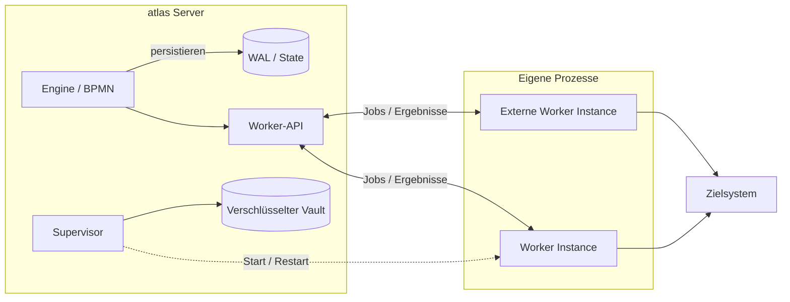
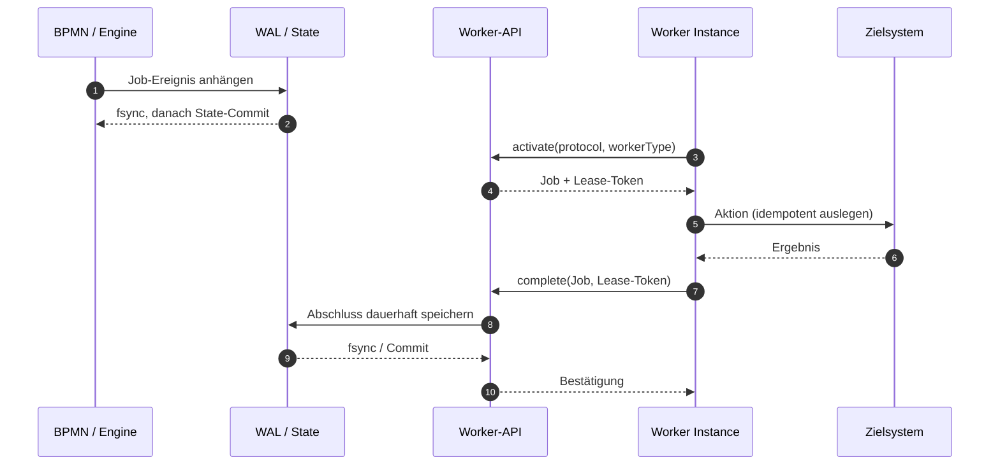
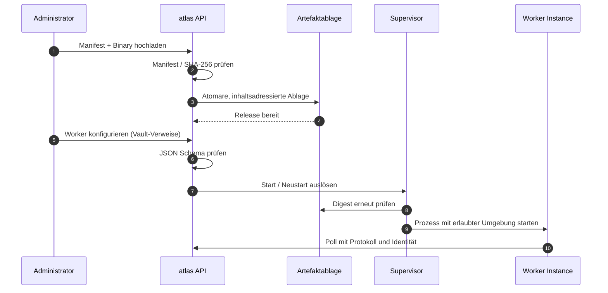

# atlas – Worker-Architektur

**Technisches Whitepaper · Entwurf 0.1**  
**Datum:** [Datum einsetzen]  
**Adressaten:** Software- und Enterprise-Architektur, Betrieb, Informationssicherheit, Hersteller von Worker Types  
**Faktenbasis:** Vom Auftraggeber bereitgestellte Beschreibung A–O. «Umgesetzt» bezeichnet den dort angegebenen Implementierungsstand; das Whitepaper ist keine unabhängige Code- oder Sicherheitsprüfung.  
**Designreferenz:** [atlas cloud](https://github.com/pblumer/atlas-cloud), Erscheinungsbild der Preview-Website.

> **Kernaussage**  
> atlas trennt die dauerhafte Ausführung von Geschäftsprozessen von Integrationscode in eigenständigen Betriebssystem-Prozessen. Das Worker-Protokoll ist umgesetzt. Die generische lokale Installation und Überwachung von Worker Types ist umgesetzt; das signierte Verteilungs- und Vertrauensmodell über atlas hub sowie die umfassende Isolation fremder Worker Types sind geplant. Vor einem produktiven Drittanbieterbetrieb bleibt insbesondere die Job-Type-Isolation pro Worker Instance offen.

## Inhaltsverzeichnis

1. [Zusammenfassung](#1-zusammenfassung)
2. [Ausgangslage und Problem](#2-ausgangslage-und-problem)
3. [Begriffe und Abgrenzungen](#3-begriffe-und-abgrenzungen)
4. [Architekturüberblick](#4-architekturüberblick)
5. [Trennung der Adressräume](#5-trennung-der-adressräume)
6. [Worker-Protokoll, Handshake und Versionierung](#6-worker-protokoll-handshake-und-versionierung)
7. [Bereitstellung der Worker-Binaries](#7-bereitstellung-der-worker-binaries)
8. [Supervisor: Start, Überwachung und Konfiguration](#8-supervisor-start-überwachung-und-konfiguration)
9. [atlas hub: Verteilung, Signaturen und Kuratierung](#9-atlas-hub-verteilung-signaturen-und-kuratierung)
10. [Berechtigungen und Credentials](#10-berechtigungen-und-credentials)
11. [Sicherheit: Bedrohungen, Schutzmassnahmen, Restrisiken](#11-sicherheit-bedrohungen-schutzmassnahmen-restrisiken)
12. [Qualität der Abarbeitung](#12-qualität-der-abarbeitung)
13. [Aktualisierung, Versionierung und Widerruf](#13-aktualisierung-versionierung-und-widerruf)
14. [Zielumgebungen](#14-zielumgebungen)
15. [Lizenzmodell – Vorschlag](#15-lizenzmodell--vorschlag)
16. [Vorteile und faire Gegenposition](#16-vorteile-und-faire-gegenposition)
17. [Grenzen, offene Fragen und nächste Schritte](#17-grenzen-offene-fragen-und-nächste-schritte)
18. [Statustabelle](#18-statustabelle)

---

## 1. Zusammenfassung

**Umgesetzt.** atlas ist eine in Go implementierte BPMN-2.x-Workflow-Engine, die als einzelnes Server-Binary ausgeliefert wird. Sie protokolliert Zustandsänderungen zuerst als Ereignisse im Write-Ahead-Log (WAL, ein vor dem State-Commit geschriebener Ereignisspeicher). Auf das Anhängen und dauerhafte Synchronisieren mittels `fsync` folgt der Commit. Pro Partition ist eine einzige Goroutine schreibend tätig. Der Grundsatz *durable before visible* bedeutet für Worker: Ein Job wird erst angeboten, wenn er dauerhaft gespeichert ist.

**Umgesetzt.** Die bisher fest einkompilierten Integrationen werden durch ein Modell ergänzt, in dem Worker Types ausserhalb des Engine-Adressraums laufen. Das sprachneutrale Worker-Protokoll, ein Go-SDK, ein separates `atlas-workers`-Binary, die Installation lokaler Artefakte und die supervisor-gesteuerte Ausführung sind vorhanden. Ein Pilot-Worker Type demonstriert den vollständigen Pfad in einem automatisierten End-to-End-Test.

**Umgesetzt, mit Einschränkung.** Ein Worker erhält Jobs nach einem Lease-Verfahren mit einer Zustellgarantie von *mindestens einmal* (at least once). Ein Lease-Token schützt die Engine vor verspäteten Abschlussmeldungen. Ein fehlerhafter Worker wird von der Engine adressraumseitig getrennt; die vollständige Betriebssystem-Isolation installierter Drittanbieter-Artefakte ist damit aber noch nicht erreicht.

**Geplant.** atlas hub soll Worker Types in signierten Releases distribuieren. Publisher- und Registry-Signaturen sollen voneinander getrennt sein; Installation und Aktualisierung bleiben explizite Betreiberentscheidungen. Container-/Kubernetes-Launcher, signierte Widerrufe und feinere Vertrauensrichtlinien sind ebenfalls geplant.

**Offene Sicherheitslücke.** Alle installierten Worker Types teilen derzeit ein API-Token mit Scope `worker`. Dieser Scope grenzt das Protokoll ein, jedoch **nicht** die Job-Typen einzelner Worker Types. Die Entscheidung über Token pro Instanz mit Bindung an Manifest-Job-Typen ist ausstehend und gilt als Voraussetzung für produktiven Drittanbieterbetrieb.

## 2. Ausgangslage und Problem

**Umgesetzt – Ausgangssituation.** Die ursprüngliche Verteilung enthält 33 fest einkompilierte Integrationen, unter anderem für Jira, Mail, SQL, Active Directory, Entra ID und Exchange. Teile davon besitzen typspezifischen Servercode, beispielsweise für Konfigurationsprüfungen, Credential-Übergabe oder Mock-Ansichten. Damit ist die Lifecycle-Verantwortung für die Integrationen direkt an diejenige der Engine gekoppelt.

Eine geänderte Integration oder eine Sicherheitslücke in ihrer Abhängigkeit erfordert in diesem Modell ein neues atlas-Release. Drittanbieter können keine unabhängig auslieferbaren Integrationen beisteuern. Gleichzeitig wächst die Angriffsfläche des Prozesses, der die dauerhafte Ausführung und den Zustand der Engine verwaltet.

**Umgesetzt – Zielrichtung in der Migration.** Das neue Konzept behandelt externe Integrationen als Worker Types mit eigenem Prozess und standardisiertem HTTP-Vertrag. Es trennt die langlebige Prozessausführung von den potenziell wechselnden Technologien, Protokollen und Abhängigkeiten eines Zielsystems. Das beseitigt weder die Notwendigkeit operativer Freigaben noch die Notwendigkeit, Integrationen auf Vertrauenswürdigkeit zu prüfen.

**Geplant – vollständige Entkopplung.** Noch sind alle eingebauten Worker Types im Server-Binary enthalten, weil einzelne weiterhin innerhalb des Server-Prozesses arbeiten. Die vollständige Entfernung ist ein späterer Migrationsschritt. Daher ist «Integrationscode ist heute vollständig vom Server entkoppelt» ausdrücklich **keine** zutreffende Beschreibung des aktuellen Stands.

## 3. Begriffe und Abgrenzungen

| Begriff | Bedeutung | Status |
|---|---|---|
| **Worker Type** | Installierbare Implementierung einer Integrationsfähigkeit, z. B. «Jira». | umgesetzt |
| **Worker** | Konfiguration eines Worker Types mit Ziel, Identität und Credential-Verweisen, z. B. `jira-produktion`. | umgesetzt |
| **Worker Instance** | Laufender Betriebssystem-Prozess, der Jobs abarbeitet. Pro Worker sind null bis viele Instanzen möglich. | umgesetzt |
| **Job** | Dauerhafte Arbeitseinheit für einen BPMN Service Task. | umgesetzt |
| **Supervisor** | Serverkomponente, die von ihr verwaltete Worker Instances startet und überwacht. | umgesetzt |
| **Lease** | Zeitlich begrenzte Zuordnung eines Jobs zu einer Worker Instance. | umgesetzt |
| **Digest** | Kryptografischer Hash, hier SHA-256, zur Prüfung der unveränderten Bytes eines Artefakts. | umgesetzt |
| **Vault** | Verschlüsselte Ablage für Zugangsdaten und andere Secrets. | umgesetzt |
| **Publisher** | Herausgeber eines Worker-Type-Releases, dessen Signatur die Release-Angaben absichern soll. | geplant |
| **Registry** | Verzeichnis signierter Release-Metadaten, das Releases listet und Widerrufe publizieren soll. | geplant für Worker Types |

**Umgesetzt.** Nicht jede Aktivität im Prozessmodell ist ein Worker. Deterministische Engine-Semantik – FEEL-Ausdrücke, DMN und User Tasks – verbleibt in Engine-internen Handlern. Ein Worker übernimmt dagegen die Bearbeitung von Jobs für externe Integrationen.

**Abgrenzung.** Der *Worker Type* bezeichnet die Implementierung; der *Worker* deren konfigurierte Verwendung; die *Worker Instance* den ausführenden Prozess. Diese drei Ebenen sind auch für Identität, Überwachung und Governance separat zu betrachten.

## 4. Architekturüberblick

**Umgesetzt.** Die Engine erzeugt einen persistenten Job, den eine Worker Instance über HTTP aktiviert. Die Worker Instance führt ihre Aktion gegenüber einem Zielsystem aus und meldet Abschluss, technischen Fehler oder BPMN-Fehler. Der Supervisor kann Worker Instances auf demselben Host verwalten; externe Instanzen werden durch den Betreiber selbst gestartet.

*Abbildung 1: Komponentenübersicht. Die logische Darstellung zeigt den umgesetzten Ausführungspfad. Ein konkreter Schutz gegen bösartigen Drittanbieter-Code über den Betriebssystem-Prozess hinaus ist noch geplant.*

**Umgesetzt.** Ein Service Task wird nicht durch das Starten einer beliebigen Programmdatei ausgeführt. Zwischen Prozessausführung und Zielsystem stehen die Engine, ein dauerhaft erzeugter Job, das API-Protokoll und der ausführende Worker. Der Supervisor entscheidet über den Lebenszyklus der von ihm gestarteten Worker Instances; er ersetzt nicht die fachlichen Entscheidungen im BPMN-Modell.

**Umgesetzt.** Der Server bietet ein separates Binary `atlas-workers`, das den Worker-Modus enthält, aber nicht Server, Engine, Web-Oberfläche oder MCP-Server. Die gemessenen Grössen für `linux/amd64` betragen 88 MB für `atlas` und 35 MB für `atlas-workers`. Dies ist eine Grössenangabe für Binaries, kein Laufzeit- oder Ressourcenbenchmark.

**Architekturelle Wirkung.** Der Datenfluss bewahrt die Ereignis- und Zustandsverantwortung innerhalb von atlas. Die Worker Instance erhält keine direkte Berechtigung, WAL, Partition-State oder Engine-internen Speicher zu mutieren.

## 5. Trennung der Adressräume

**Umgesetzt.** Installierter Fremdcode wird als eigener Betriebssystem-Prozess ausgeführt. Bewusst nicht gewählt wurden Go-Plugins (`plugin.Open`), WebAssembly im Engine-Prozess und beliebige Kommandozeilen aus installierten Paketen. Für die Kommunikation ist ausschliesslich das HTTP-basierte Worker-Protokoll vorgesehen.

Diese Trennung begrenzt die unmittelbare Auswirkung von Worker-Abstürzen auf den Engine-Prozess. Sie verhindert nicht automatisch, dass ein Worker im Rahmen seiner Betriebssystemrechte Dateien liest, Netzwerke anspricht oder bereitgestellte Credentials missbraucht. Prozessgrenze und Sandbox sind unterschiedliche Sicherheitskontrollen.

**Umgesetzt.** Das Go-Paket `workersdk` importiert keine atlas-Engine-Pakete, keine Speicher-Engine und keine weiteren atlas-Pakete. Ein automatischer Test erzwingt diese Abhängigkeitsgrenze. Der Vertrag ist sprachneutral: Ein Worker Type muss nicht in Go implementiert sein.

**Umgesetzt.** Findet der Supervisor `atlas-workers` neben dem Server-Binary, verwendet er es für eingebaute Worker Types. Andernfalls wird der Worker-Modus des Server-Binaries verwendet. Mit `ATLAS_WORKERS_BINARY` kann der Betreiber `self` oder einen Pfad wählen.

**Geplant.** Eingebaute Integrationen, die heute noch serverseitige Bestandteile besitzen, werden sukzessive migriert. Erst nach der vollständigen Migration kann der Integrationscode aus dem Server-Binary entfernt werden.

## 6. Worker-Protokoll, Handshake und Versionierung

**Umgesetzt.** Das Worker-Protokoll v1 ist als sprachneutraler Vertrag dokumentiert. Das Aktivieren eines Jobs geschieht mittels Long Polling: Der Client darf auf eine Antwort mit Arbeit warten, statt in sehr kurzen Intervallen leere Abfragen zu senden. Die eigentliche Zuweisung wird über ein Lease abgesichert.

| Operation | Zweck | Status |
|---|---|---|
| `POST /api/v1/jobs/activate` | Jobs aktivieren und Lease erhalten | umgesetzt |
| `…/complete` | Job erfolgreich abschliessen | umgesetzt |
| `…/fail` | Technisch fehlgeschlagenen Job mit Wiederholungsintervall melden | umgesetzt |
| `…/error` | Fachlichen BPMN-Fehler melden | umgesetzt |
| `…/authorize` | Ausführungsentscheidung vor einer Zielsystemaktion einholen | umgesetzt |
| `/api/v1/worker-queries/activate` | Kurzlebige Formular-Abfrage aktivieren | umgesetzt |
| `/api/v1/worker-queries/answer` | Ergebnis einer Formular-Abfrage liefern | umgesetzt |

**Umgesetzt.** Jeder Poll trägt die Hauptversion `protocol` sowie optional `workerType` mit `id`, `version` und `digest`. Ohne explizite Versionsangabe wird Version 1 angenommen. Innerhalb einer Hauptversion sind Änderungen additiv. Der Server akzeptiert die aktuelle und die unmittelbar vorherige Hauptversion (N/N−1). Eine unbekannte Version führt zu HTTP 400 mit Angabe der unterstützten Versionen; jede Antwort enthält `X-Atlas-Worker-Protocol`.

*Abbildung 2: Job von der Erzeugung bis zum Abschluss. Vereinfachter Erfolgsfall. Im Fehlerfall gelten Wiederholung, Incident oder BPMN-Fehlerbehandlung gemäss Kapitel 12.*

**Umgesetzt.** Ein Lease-Token schützt vor verspäteten Ergebnissen. Nach Ablauf des Leases weist die Engine eine Meldung des alten Besitzers ab, während der Job erneut angeboten werden kann. Damit ist ein doppelter externer Effekt nicht ausgeschlossen: Die Verarbeitung muss für Seiteneffekte idempotent gestaltet werden.

**Umgesetzt.** Formular-Lookups sind nicht dauerhaft. Fehlerantworten enthalten nur einen Code und keine potenziell personenbezogene Suchzeichenfolge aus einer Anbieterfehlermeldung.

## 7. Bereitstellung der Worker-Binaries

**Umgesetzt.** Ein Administrator kann für die Plattform des Servers ein Manifest und ein ausführbares Artefakt per Multipart-Upload an `POST /api/v1/worker-types/installed` übergeben. Der Server prüft die Datei gegen den im Manifest angegebenen SHA-256-Digest, bevor er sie behält. Die Ablage erfolgt inhaltsadressiert unter `<data>/workertypes/<id>/<version>/<sha256>/`; die Dateien werden atomar geschrieben, Metadaten zuletzt.

**Umgesetzt.** Ein Release ist unveränderlich. Wird dieselbe Version mit identischem Digest erneut eingereicht, ändert sich nichts. Bei gleichem Release-Namen, aber anderem Digest antwortet die API mit HTTP 409. Per `GET` können installierte Releases aufgelistet und per `DELETE …/{id}/{version}` entfernt werden; vor dem Entfernen stoppt der Supervisor die Instanz.

**Umgesetzt.** Das Manifest verwendet `apiVersion: atlas.io/v1alpha1` und `kind: WorkerType`. `metadata.id` nutzt umgekehrte DNS-Schreibweise wie `com.example.sap-s4`, `metadata.version` SemVer. Unter `spec` werden Job-Typen, Operationen, Artefakte und ein JSON Schema zur Konfiguration deklariert. Ein Artefakt nennt `platform` (`os/arch`), den Media Type `application/vnd.atlas.worker.executable` und einen SHA-256-Digest.

*Abbildung 3: Installation und Start eines Worker Types. Die manuelle lokale Installation ist umgesetzt; der signierte Hub-Download ist es noch nicht.*

**Geplant.** Für netzverbundene Systeme ist ein signaturgeprüfter Download aus atlas hub vorgesehen. Für isolierte Netze ist Datei-Import geplant. Erstanbieter-Artefakte sollen dem Distributionsarchiv beigelegt sein. Pflichtplattformen für Hub-Listings sollen `linux/amd64`, `linux/arm64` und `windows/amd64` sein; OCI-Images sind optional.

## 8. Supervisor: Start, Überwachung und Konfiguration

**Umgesetzt.** Der Supervisor startet installierte Programme ohne Kommandozeilenargumente. Die Startumgebung besteht aus einer Positivliste – unter anderem `PATH`, `HOME`, temporäre Verzeichnisse, Locale und Proxy-Variablen – und dem expliziten Worker-Vertrag. Die übrige Serverumgebung wird nicht übernommen.

| Startvariable | Bedeutung | Status |
|---|---|---|
| `ATLAS_SERVER_URL` | Zieladresse des atlas-Servers | umgesetzt |
| `ATLAS_WORKER_ID` | Kennung des konfigurierten Workers | umgesetzt |
| `ATLAS_TOKEN` | API-Zugang mit Scope `worker` | umgesetzt |
| `ATLAS_WORKER_TYPE_ID` | Vom Supervisor geprüfte Type-ID | umgesetzt |
| `ATLAS_WORKER_TYPE_VERSION` | Vom Supervisor geprüfte Release-Version | umgesetzt |
| `ATLAS_WORKER_TYPE_DIGEST` | Vom Supervisor geprüfter Digest | umgesetzt |
| `ATLAS_WORKER_CONFIG` | Aufgelöste Konfiguration, einschliesslich der nötigen Secrets | umgesetzt |

**Umgesetzt.** Vor jedem Start berechnet der Supervisor den Artefakt-Digest erneut. Ist die Programmdatei verändert, wird ihr Start im Zustand `refused` verweigert. Installierte Releases werden beim Serverstart wieder gestartet. Ein abgestürzter Worker wird mit anwachsender Wartezeit zwischen 0,5 und 30 Sekunden neu gestartet.

**Umgesetzt.** Ein Worker ohne erforderliche Konfiguration endet mit Exit-Code 78 und wird geparkt, statt endlos neu zu starten. Sobald Konfiguration vorhanden ist, kann er wieder anlaufen. Unter Windows enden überwachte Worker auch bei einem Absturz des Servers; dazu gehört ADR-0439.

**Umgesetzt.** Ein Administrator konfiguriert Worker mit `PUT /api/v1/worker-types/installed/{id}/workers/{name}`. Einstellungen werden gegen das JSON Schema jedes installierten Releases geprüft. Als Secret wird ausschliesslich der Name eines Vault-Eintrags referenziert; der Server löst den Wert erst für den Start auf. Eine Konfigurationsänderung löst einen Neustart der Worker Instance aus. Dafür ist keine typspezifische Serverlogik erforderlich.

**Umgesetzt.** Ein Echo-Pilot, der nur das `workersdk` verwendet, zeigt den vollständigen Installations- und Ausführungspfad in einem automatisierten End-to-End-Test.

**Geplant.** Für vorgezogene Betriebsdiagnosen fehlen `check-connection` und `diagnostics`. Auch `validate-config` als Worker-seitige Abfrage ist noch offen. Der heutige schema-basierte Konfigurationscheck ist davon zu unterscheiden.

## 9. atlas hub: Verteilung, Signaturen und Kuratierung

**Umgesetzt, aber noch nicht für Worker Types.** atlas hub verfügt für Application Blueprints bereits über eine statische Registry mit `index.json` und Ed25519-Signatur über die exakten Index-Bytes. Der vertrauenswürdige Schlüssel ist beim Betreiber fest hinterlegt. Es gibt weder «Trust on first use» noch eine Schlüsselübernahme aus heruntergeladenen Inhalten. Bis zu zwei Schlüssel können für einen Wechsel parallel hinterlegt sein. Die Ankündigung neuer Schlüssel nutzt einen mit dem alten Schlüssel signierten Kanal mit mindestens sieben Tagen Vorlauf. Downloads unterliegen Grössengrenzen, Weiterleitungs- und SSRF-Schutz (SSRF: unerwünschte Serveranfragen durch fremde Adressen).

**Geplant für Worker Types.** Eine neue Release-Art `worker-type` soll in einer neuen Version des Index-Schemas erscheinen. Zwei voneinander unabhängige Signaturen werden Pflicht: eine Publisher-Signatur über Manifest- und Artefakt-Digests sowie eine Registry-Signatur über den Index. Ein Namespace soll genau einem Publisher gehören. `io.atlas.*` soll ausschliesslich mit dem atlas-Release-Schlüssel akzeptiert werden.

**Geplant.** Vorgesehen sind vier Herkünfte: kostenlose atlas-Releases, kommerzielle atlas-Releases, Community-/Drittanbieter-Releases und organisationsinterne Releases über eigene Registries oder Datei-Import.

**Vorschlag: Kuratierungsrichtlinie, Status «Proposed».** Die Stufe `verified` verlangt geprüfte Identität und Domain, Build-Herkunft, automatische Prüfungen sowie manuelles Review. Bei geschlossenem Quellcode kann das Review unter Geheimhaltung erfolgen; alternativ sind Herstellerzusicherung plus Verhaltenstest vorgesehen. Diese Stufe wäre standardmässig erlaubt. Die Stufe `community` verlangt Identitätsprüfung und automatisierte Prüfungen, wäre standardmässig abgelehnt und – bei Freigabe – nur mit Container oder Kubernetes zugelassen. Ungeprüfter Code würde nicht mit dem Hub-Schlüssel signiert, sondern nur in bewusst hinzugefügten Drittregistries verfügbar sein.

**Geplant.** Der signierte Index soll pro Release offenlegen, welche Prüfungen durchgeführt wurden. Eine Signatur bescheinigt dann nachvollziehbare Herkunft und geprüfte Metadaten, **nicht** die Schadlosigkeit des Codes.

## 10. Berechtigungen und Credentials

### 10.1 Rollen, API-Zugriff und Worker-Scope

**Umgesetzt.** Die API verwendet die Rollen `admin`, `operator`, `modeler` und `user`. Routen des Worker-Protokolls verlangen mindestens die Rolle `operator`. Installation, Konfiguration und Entfernung von Worker Types bleiben Administratoren vorbehalten und sind bewusst nicht als MCP-Aktionen für KI-Agenten verfügbar.

**Umgesetzt.** Maschinen nutzen API-Tokens mit einem Scope (Geltungsbereich), wie in ADR-0194 beschrieben. Der Scope `worker` ist eine abschliessende Positivliste ausschliesslich für das Worker-Protokoll. Selbst eine weiter reichende Rolle erweitert diesen Scope nicht. Auch das vom Supervisor ausgestellte interne Token verwendet den Scope `worker` (ADR-0297). Externe Worker benötigen ein entsprechend beschränktes `ATLAS_TOKEN`; ein ungültiges Token führt beim Start zu einer Serverwarnung.

**Offene Lücke – sicherheitskritisch.** Aktuell erhalten alle installierten Worker Types **dasselbe** Token mit Scope `worker`. Das Token begrenzt die API-Routen, aber **nicht die Job-Typen** einer Worker-Type-Installation. Damit kann ein installierter Worker Type technisch Jobs anderer Typen aktivieren. Ein Token pro Instanz mit Beschränkung auf die im Manifest deklarierten Job-Typen ist noch nicht entschieden. Vor dem produktiven Einsatz fremder Worker Types ist diese Grenze verbindlich zu schliessen.

### 10.2 Ablage und Übergabe von Secrets

**Umgesetzt.** Zielsystem-Credentials werden weder in BPMN-Modellen noch in Ereignissen oder im WAL abgelegt. Ein Job transportiert aufgelöste Fachwerte, nicht die Zugangsdaten (ADR-0168). Secrets liegen im verschlüsselten Server-Vault (ADR-0069/0070), der standardmässig eingeschaltet ist. Sein Schlüssel wird erzeugt und ist nur für das Dienstkonto lesbar; alternativ kann der Betreiber `ATLAS_VAULT_KEY` setzen. Jeder Eintrag ist einzeln versiegelt. Eine Manipulation oder ein unpassender Schlüssel führt zu einem Fehler statt zu einer stillen Fehlinterpretation.

| Ausführungsart | Ort / Übergabe der Credentials | Status |
|---|---|---|
| Extern betriebener Worker | Verwaltet seine Zielsystem-Credentials selbst; der atlas-Server kennt sie nicht. | umgesetzt |
| Überwachter eingebauter Worker | Erhält Credentials beim Start aus dem Vault. | umgesetzt |
| Installierter Worker Type | Konfiguration referenziert Vault-Einträge; aufgelöste Secrets gelangen beim Start in `ATLAS_WORKER_CONFIG`. | umgesetzt |
| Installierter Worker Type mit Credential-Broker pro Job | Job-bezogene Ausgabe statt Startübergabe. | **geplant / offen** |

**Umgesetzt.** Eine Worker Instance meldet bei Job-Abrufen ausschliesslich die Namen der Worker, für die sie Credentials hält. Der Server gibt Jobs, die einen bestimmten Worker nennen, nur an eine Instance aus, die diesen Worker hält. Die Namen dienen also der Job-Zuordnung; die Secret-Werte werden nicht im Poll transportiert.

### 10.3 Identitätsbewusste Ausführung

**Umgesetzt, für vom Server kontrollierte Aktionen (ADR-0475).** Vor einer Aktion am Zielsystem kann der Worker über `/authorize` die Berechtigung einholen. Die Engine persistiert ihre Entscheidung vor der Antwort. Die Antwort bindet die Autorisierung an die berücksichtigten Parameter. Die Modi sind `off` (keine Richtlinie), `shadow` (entscheiden und protokollieren, ohne durchzusetzen) und `enforce` (durchsetzen).

**Umgesetzt, begrenzter Einsatzbereich.** Eine delegierte Aktion kann ein kurzlebiges Token im Namen der Person erhalten, aber nur für vom Server überwachte Worker Instances, die einen Broker-Schlüssel vorweisen. Bei Ablehnung ist der Job serverseitig bereits abgeschlossen; der Worker übermittelt dann keine weitere Abschlussmeldung.

**Nicht umgesetzt für installierte Worker Types.** Der Credential-Broker pro Job fehlt. Das ist von der grundsätzlichen Funktion der Autorisierungs-API und den bereits vorhandenen Delegationsmöglichkeiten zu trennen.

## 11. Sicherheit: Bedrohungen, Schutzmassnahmen, Restrisiken

### 11.1 Der tatsächlich vorhandene Schutz

**Umgesetzt.** Die Engine startet installierte Worker Types nicht in ihrem eigenen Prozess. Installer und Supervisor prüfen Artefakt-Digests bei der Installation bzw. vor jedem Start. Die Prozessumgebung wird auf eine Positivliste reduziert; Secrets sind auf Vault-Verweise in der Konfiguration begrenzt. Worker-Type-Verwaltung erfordert Administratorrechte und ist nicht über MCP erreichbar.

**Umgesetzt, mit wesentlicher Einschränkung.** Unsigned-Installationen sind standardmässig mit HTTP 403 abgelehnt und können nur über `--allow-unsigned-worker-types` freigegeben werden. Dieser Schalter ist ausdrücklich für Entwicklung vorgesehen. Eine technische Signaturprüfung für Worker Types ist noch **nicht** umgesetzt. Somit darf der heutige lokale Pilotpfad nicht mit einer produktionsreifen signierten Software-Lieferkette verwechselt werden.

### 11.2 Bedrohungsmodell des geplanten Hub-Vertrauenssystems

| Angriffsszenario | Geplante Begrenzung / verbleibende Wirkung | Status |
|---|---|---|
| Nur Publisher-Schlüssel kompromittiert | Der Angreifer kann signieren, aber nicht in fremden Registries oder Namespaces listen. | geplant |
| Nur Registry-Schlüssel kompromittiert | Der Angreifer kann listen und widerrufen, jedoch keine gültige neue Publisher-Signatur erzeugen. | geplant |
| Beide Schlüssel kompromittiert | Bösartige Releases können gelistet werden; Installation bleibt explizite Betreiberentscheidung. | geplant |
| Registry-Host kompromittiert | Veränderte oder unpassende Bytes bestehen Digest- bzw. Signaturprüfung nicht. | geplant |

**Geplantes Restrisiko.** Ein Betreiber könnte ein schädliches Update genehmigen, dessen beide Signaturen gültig sind. Der vorgesehene Entscheidungsdialog soll deshalb Publisher, Signaturstatus, Digest und geänderte Anforderungen offenlegen. Diese Anzeige reduziert nicht die technische Wirkung eines bereits genehmigten schädlichen Workers.

**Geplant.** Signierte Widerrufe sollen Release-ID, Versionsbereich oder Digest, Schweregrad und Grund nennen. Ein Widerruf soll nur verhindern oder stoppen können, nicht installieren, starten oder umkonfigurieren. Damit soll der Hub kein Fernsteuerungskanal werden. Beim Stilllegen eines Workers bleiben seine Jobs dauerhaft vorhanden. Ohne Registry-Verbindung soll die letzte verifizierte Liste mit Altersanzeige gelten.

**Geplant.** Die Vertrauensrichtlinie soll erlaubte Registries, Publisher, Namespaces und Launcher abhängig von der Vertrauensstufe begrenzen. Unter Linux sind Landlock/seccomp analog zur vorhandenen Script-Sandbox vorgesehen. Unter Windows soll ein Job-Objekt zunächst Ressourcengrenzen setzen, jedoch keine gleichwertige Abschottung bieten. Ein fremder Worker Type soll deshalb unter Windows als Prozess nur nach ausdrücklicher Freigabe laufen. Diese OS-Abschottung ist für installierte Artefakte **nicht umgesetzt**.

### 11.3 Ausdrücklich verbleibende Risiken

**Offen.** Ein kompromittierter Worker kann mit dem heute gemeinsam genutzten Worker-Token Jobs ausserhalb seiner deklarierten Job-Typen aktivieren. Zusätzlich erhält ein installierter Worker Type seine aufgelösten Secrets zur Startzeit und nicht über einen pro Job gebundenen Credential-Broker. Die Prozessgrenze schützt den Engine-Adressraum, aber nicht automatisch das Betriebssystem, das lokale Netzwerk oder die übergebenen Zielsystem-Credentials.

**Offen.** Die Unterlagen belegen keine bereits implementierte End-to-End-Publisher-Signaturprüfung für Worker Types, keinen fertig durchgesetzten Revocation-Mechanismus und keine vollwertige Sandbox für installierte Binärdateien. Diese Punkte dürfen in einer Produktivfreigabe nicht als vorhandene Kontrollen ausgewiesen werden.

## 12. Qualität der Abarbeitung

### 12.1 Dauerhaftigkeit und Zustellung

**Umgesetzt.** Jobs werden erst sichtbar, wenn ihre Ereignisse dauerhaft geschrieben sind, und überstehen Neustarts von Server und Worker. Die Zustellgarantie lautet *mindestens einmal* und nicht *genau einmal*. Der Standard-Lease beträgt fünf Minuten. Ein Lease-Token verwirft verspätete Abschlussmeldungen, nachdem ein Lease ausgelaufen ist; die Arbeit kann inzwischen neu angeboten worden sein.

**Konsequenz für Hersteller.** Ein Worker-Handler mit Seiteneffekten muss idempotent sein: Eine wiederholte Bearbeitung desselben Jobs darf im Zielsystem nicht unkontrolliert denselben Effekt erneut erzeugen. Der dauerhafte Job-Key bietet sich als Deduplizierungskennzeichen an. Ein Lease-Token sichert den Engine-Status, nicht automatisch die Transaktion im entfernten Zielsystem.

### 12.2 Wiederholung, BPMN-Fehler und Incidents

**Umgesetzt.** Bei einem technischen Fehler wird ein Versuch verbraucht. Bleibt ein Versuch übrig, erfolgt der nächste Versuch nach 60 Sekunden; bleiben mehrere, nach 15 Sekunden (ADR-0111). Bei drei Standardversuchen ergeben sich insgesamt 75 Sekunden Wartezeit zwischen den Versuchen, bevor ein Incident entstehen kann. Diese Abstimmung berücksichtigt insbesondere kurzzeitige Replikationsverzögerungen bei Microsoft Graph und eine zeitnahe Störungserkennung. Auch externe Worker respektieren die von der Engine zurückgegebene Wartezeit; dies wird getestet.

**Umgesetzt.** Sind alle Versuche verbraucht, entsteht ein Incident (ADR-0061). Der Prozess wartet auf Behebung; die Behebung startet den Job erneut. Ein fachlicher BPMN-Fehler wird dagegen über `…/error` geworfen, verbraucht keinen technischen Versuch und kann durch ein passendes BPMN-Fehlerereignis behandelt werden. Ohne passende Fehlerbehandlung wartet der Job auf einem Incident.

| Situation | Verhalten | Status |
|---|---|---|
| Worker stürzt ab / Lease läuft aus | Job kann erneut angeboten werden; verspätete Rückmeldung wird abgelehnt. | umgesetzt |
| Technischer Fehler | Versuch verbrauchen, Wartezeit einhalten, gegebenenfalls Incident. | umgesetzt |
| Fachlicher BPMN-Fehler | BPMN-Fehlerpfad, kein technischer Retry-Verbrauch. | umgesetzt |
| Incident behoben | Job erneut starten. | umgesetzt |
| Poll schlägt fehl, etwa bei Server-Neustart | Worker Instance protokolliert den Fehler und pollt weiter. | umgesetzt |

### 12.3 Durchsatzschutz und Fehlerausbreitung

**Umgesetzt.** Eine Worker Instance aktiviert nur so viele Jobs, wie sie freie Ausführungsplätze besitzt (ADR-0440). Ein aktivierter Job startet unmittelbar, statt vor seinem Start bereits Lease-Zeit zu verlieren.

**Umgesetzt.** Ein Circuit Breaker, also eine Schutzschaltung bei wiederholt ausfallenden Zielsystemen, arbeitet pro Kombination von Job-Typ und Worker (ADR-0340). Er lässt Probe-Jobs zur Erkennung der Erholung zu. Das Öffnen setzt Fehler über verschiedene Prozessinstanzen voraus, damit problematische Daten eines einzelnen Vorgangs nicht die gesamte Integration blockieren. Die Störung wird beim Worker abgefangen, bevor viele Jobs unnötig Versuche verbrauchen.

### 12.4 Betriebsüberwachung

**Umgesetzt.** Die Workers-Ansicht zeigt pro Instance abonnierte Job-Typen, gehaltene Worker-Namen, Zähler für abgerufene, abgeschlossene und fehlgeschlagene Jobs, laufende Jobs je Typ, Protokollversion, Worker-Type-ID, Version und Digest. Die letzten Jobs werden samt Ein- und Ausgabe angezeigt. Dieser lokale Verlauf ist begrenzt und nach einem Neustart leer.

**Umgesetzt.** Für einen dauerhaften Job-Verlauf lässt sich ein clio-Event-Store konfigurieren (ADR-0179). Hinzu kommen Prometheus-Metriken sowie die Anzeige von in Modellen referenzierten Workern, für die keine Instance verfügbar ist. Für eingebaute Worker-Type-Operationen existieren technische Konformitätsnachweise nach ADR-0483.

**Geplant.** Konformitätsnachweise auch für ausserhalb des Repositorys gebaute Worker Types sowie Betriebsaktionen `check-connection` und `diagnostics` sind noch offen.

## 13. Aktualisierung, Versionierung und Widerruf

**Umgesetzt.** Worker-Type-Releases sind nach ID, Version und Digest unveränderlich. Eine aktualisierte Implementation wird als neue Version installiert; mehrere Versionen dürfen parallel vorhanden sein. Die Protokoll-Kompatibilität folgt der Regel aktuelle plus vorherige Hauptversion.

**Geplant.** Ein BPMN-Deployment soll Worker-Type-ID und Hauptversion festschreiben. Damit sollen Installieren oder Entfernen von Worker Types bestehende Deployments nicht verändern. Das Entfernen einer noch genutzten Version soll verweigert werden. Diese Deployment-Bindung ist derzeit **nicht** umgesetzt; die heutige Unveränderlichkeit eines installierten Releases ersetzt diese Bindung nicht.

**Geplant.** Updates erfolgen nicht automatisch. Der Betreiber entscheidet einzeln über neue Releases. Der Hub soll signierte Widerrufe verteilen und betroffene Worker stoppen, ohne Jobs zu verlieren. Die letzte validierte Widerrufsliste mit erkennbarer Aktualität soll auch bei unterbrochener Registry-Verbindung weiter gelten.

**Betriebliche Einordnung.** Die Entscheidungsfreiheit des Betreibers schützt vor einem unbemerkten automatischen Codewechsel. Gleichzeitig verlangt sie Prozesse für Freigabe, zeitnahe Sicherheitsreaktion und Nachvollziehbarkeit. Ein signierter Widerruf ersetzt nicht die Entscheidung, welche Ersatzversion im Zielbetrieb zulässig ist.

## 14. Zielumgebungen

**Umgesetzt.** Artefaktformat und Launcher werden getrennt betrachtet. Der Launcher `process` startet native Binaries auf Windows, Linux und macOS. Der Modus `external` erlaubt selbst betriebene Worker Instances auf anderen Rechnern über `atlas worker` oder `atlas-workers`. Für native Programme wird kein Container vorausgesetzt; das ist insbesondere für Windows-Umgebungen wichtig, in denen Container nicht zur Verfügung stehen.

| Umgebung / Launcher | Fähigkeit | Status |
|---|---|---|
| Windows, Linux, macOS / `process` | Nativen Worker-Prozess starten und überwachen. | umgesetzt |
| Extern / `external` | Worker unabhängig betreiben; Kommunikation über Worker-Protokoll. | umgesetzt |
| Docker oder Podman / `container` | OCI-basierten Worker starten. | geplant |
| Kubernetes / `kubernetes` | Worker über Kubernetes starten, nur nach Freischaltung wegen benötigter RBAC-Rechte. | geplant |

**Geplant.** OCI-Images sollen eine optionale Auslieferungsform für Isolation und mitgebrachte Laufzeitabhängigkeiten sein, beispielsweise PowerShell für Exchange und Teams. Das native Binary bleibt das Basisformat, weil es unabhängig von Containerdiensten einsetzbar ist.

**Sicherheitliche Differenzierung.** Die vorhandene native Prozess-Trennung ist nicht gleichzusetzen mit einer ausgereiften Linux- oder Windows-Sandbox. Unter Linux sind weitergehende Mechanismen geplant, während der vorgesehene Windows-Ansatz ausdrücklich schwächer ist. Die Wahl der Zielplattform beeinflusst daher die Freigabefähigkeit eines fremden Worker Types.

## 15. Lizenzmodell – Vorschlag

**Umgesetzt.** Die atlas-Engine ist unter **AGPL-3.0-only** lizenziert. Das Go-SDK `workersdk` ist so entkoppelt, dass es keine atlas-Pakete und insbesondere keinen AGPL-lizenzierten Engine-Code importiert. Dieser Abhängigkeitszustand wird automatisch geprüft.

**Vorschlag; nicht entschieden.** SDK und Protokollbeschreibung sollen unter **Apache-2.0** veröffentlicht werden. Ziel ist, dass Hersteller Worker Types unabhängig entwickeln und bei Bedarf ohne Offenlegung ihres eigenen Quellcodes vertreiben können. Das SDK als eigenständiges Go-Modul bleibt bis zur Lizenzentscheidung zurückgestellt.

**Offen.** Die Zustimmung der betroffenen Rechteinhaber und die juristische Beurteilung sind noch ausstehend. Deshalb darf dieses Whitepaper weder eine bereits vollzogene Apache-2.0-Lizenzierung noch eine verbindliche Aussage zu allen lizenzrechtlichen Folgen für Drittanbieter behaupten.

## 16. Vorteile und faire Gegenposition

### 16.1 Vorteile des neuen Modells

**Umgesetzt bzw. durch Umgesetztes ermöglicht.** Externe Worker-Prozesse reduzieren die unmittelbare Kopplung zwischen Integrationsfehlern und Engine-Laufzeit. Ein eigener Protokollvertrag begrenzt die technische Schnittstelle. Installation per Manifest, inhaltsadressierte Ablage und konfigurierbare Worker schaffen den Grundpfad, über den später unabhängige Releases möglich werden.

**Geplanter Nutzen, noch nicht vollständig realisiert.** Mit dem vollständigen Hub- und Migrationsmodell könnten Integrationen unabhängig ausgeliefert, geprüft, signiert und aktualisiert werden. Drittanbieter und interne Organisationen könnten eigene Worker Types anbieten. Sicherheitskorrekturen müssten dann nicht zwangsläufig mit einem vollständigen Engine-Release zusammenfallen.

### 16.2 Die stärkste Gegenposition

**Gegenposition.** Alle Integrationen fest einzukompilieren ist aus Betriebssicht plausibel: Ein Binary, eine Version, weniger Komponenten, keine zusätzliche Software-Lieferkette und ein einfacher Start auf Windows-Rechnern ohne Container. Versionsunterschiede zwischen Engine und Workern entfallen. Installation, Freigabe und Support sind organisatorisch zunächst leichter zu kontrollieren.

**Abwägung.** Diese Einfachheit wird mit einer dauerhaft gekoppelten Release-Frequenz und wachsender Vertrauensfläche erkauft. Jede Änderung einer Integration muss den Engine-Release-Prozess durchlaufen. Eine Sicherheitslücke in einer Integrationsabhängigkeit ist dadurch eine Frage der Engine-Auslieferung. Gleichzeitig bleibt die Erweiterung durch Dritte eingeschränkt. Das neue Modell löst diese Probleme nur dann überzeugend, wenn seine zusätzlichen Sicherheits- und Betriebsmechanismen tatsächlich vollständig umgesetzt werden.

### 16.3 Echte Kosten des neuen Modells

**Grenzen.** Eine Kompatibilitätsmatrix aus atlas-, Worker-Type- und Protokollversion entsteht. Mehr Artefakte, Plattformpakete und Launcher müssen getestet werden. Signaturen und Kuratierung erfordern Governance; bei geschlossenem Quellcode entstehen Haftungs- und Review-Fragen. Die Isolation bleibt unter Windows schwächer. Die Migration anspruchsvoller Integrationen – insbesondere Active Directory, Entra, Exchange, Teams Phone, SQL, Mail und Script – ist aufwendig.

**Bewertung.** Die Architektur ist für einen offen erweiterbaren Integrationsmarkt geeignet, solange Sicherheitsreife nicht mit der blossen Existenz eines Worker-Protokolls gleichgesetzt wird. Für einen streng kontrollierten Betrieb kann das einkompilierte Modell weiterhin eine sachlich vertretbare Option sein, bis die noch offenen Vertrauensgrenzen geschlossen sind.

## 17. Grenzen, offene Fragen und nächste Schritte

### 17.1 Unmittelbare Sperrpunkte

**Offen – vor produktivem Drittanbieterbetrieb zu entscheiden.** Erstens muss der Scope von installierten Worker Instances an die erlaubten Manifest-Job-Typen gebunden werden. Ein gemeinsames Token für alle installierten Worker Types ist keine ausreichende Mandatsgrenze. Zweitens fehlen die pro Release verifizierte Signaturkette und ihre Durchsetzung für Hub-Installationen. Drittens fehlt die Betriebssystemabschottung installierter Fremd-Artefakte. Viertens fehlt der Credential-Broker pro Job für installierte Worker Types.

Diese Punkte sind nicht bloss Bedienungsverbesserungen. Sie entscheiden, welche Code- und Zielsystemrechte ein fremder Publisher faktisch erhält. Bis zu ihrer Umsetzung ist der heutige Installationspfad als kontrollierter Pilotpfad und nicht als allgemeine Drittanbieter-Plattform zu behandeln.

### 17.2 Migrationsschritte nach vorliegender Faktenbasis

| Schritt | Gegenstand | Status |
|---|---|---|
| 1 | SDK, Protokollbeschreibung und Handshake | umgesetzt; eigenes SDK-Go-Modul zurückgestellt |
| 2 | Separates `atlas-workers`-Binary | umgesetzt |
| 3 | Geprüfte lokale Artefakte, Supervisor, Pilot-Worker Type | umgesetzt |
| 4 | Generische Serverhälfte, Schema und Vault-Verweise | teilweise umgesetzt |
| 5 | Signaturen, Worker-Type-Release im Hub, Widerruf | geplant; Voraussetzung vor öffentlichem Worker-Binary |
| 6 | Container- und Kubernetes-Launcher | geplant |
| 7 | Migration aufwendiger eingebauter Worker Types | geplant |
| 8 | Entfernen eingebauter Worker Types aus dem Server-Binary | geplant |

### 17.3 Offene fachliche und technische Fragen

**Offen:** Wie genau werden pro Worker Instance Tokens ausgestellt, erneuert und an die Manifest-Job-Typen gebunden? Wie wird die Zuordnung eines BPMN Service Tasks zu einem **bestimmten** Worker umgesetzt? Wann wird der Credential-Broker für installierte Worker Types verfügbar? Wie werden `validate-config`, `check-connection` und `diagnostics` spezifiziert und abgesichert?

**Offen:** Welcher verbindliche Review- und Haftungsprozess gilt für `verified` und `community`? Welche Vertrauensstufen dürfen auf Windows ohne starke Sandbox ausgeführt werden? Wie wird eine produktive Sicherheitsfreigabe geprüft, solange Signaturprüfung, Widerruf und Sandbox noch nicht ausgerollt sind?

**Offen:** Wie wird die geplante Deployment-Bindung von Worker-Type-ID und Hauptversion mit vorhandenen Deployments, parallel installierten Versionen und Löschsperren eingeführt? Wie werden externe Konformitätsnachweise unabhängig vom atlas-Repository erzeugt? Wann können die integrierten Worker Types vollständig aus dem Server entfernt werden?

**Vorschlag für die Reihenfolge.** Zuerst die Job-Type-Sicherheitsgrenze pro Instance entscheiden und testen; anschliessend die generische Zuordnung im BPMN-Modell und den pro Job gebundenen Credential-Broker vervollständigen. Vor einer öffentlichen Worker-Type-Distribution Signaturprüfung, Freigabedialog, Widerruf und Plattformrestriktionen abschliessen. Danach externe Konformitätstests, Launcher und die schrittweise Migration komplexer Worker Types durchführen. Das ist eine Empfehlung auf Basis der beschriebenen Risiken, keine behauptete Projektplanung.

## 18. Statustabelle

Die folgenden Statusangaben beziehen sich ausschliesslich auf die bereitgestellte Faktenbasis. «Teilweise» wird in der Erläuterung präzisiert; die Spalte verwendet die geforderten Werte **umgesetzt**, **geplant** oder **Vorschlag**.

| Funktion / Entscheidung | Status | Einordnung |
|---|---|---|
| Durable Jobs, WAL vor Sichtbarkeit, Single Writer | umgesetzt | Engine-Grundlage |
| Worker-Protokoll v1 inkl. `activate`, `complete`, `fail`, `error` | umgesetzt | HTTP-Vertrag |
| Versionierter Handshake, N/N−1 | umgesetzt | Poll mit optionaler Identität |
| Formular-Lookups mit minimierten Fehlerdetails | umgesetzt | Kurzlebig, nicht dauerhaft |
| Prozess-Trennung für installierte Worker Types | umgesetzt | Keine vollständige OS-Sandbox |
| `workersdk` ohne atlas-Engine-Abhängigkeiten | umgesetzt | Automatisch geprüft |
| Eigenes Binary `atlas-workers` | umgesetzt | Eingebaute Types noch im Server-Binary |
| Lokaler Upload, SHA-256-Prüfung, unveränderliche Releases | umgesetzt | Administrations-API |
| Schema-Konfiguration mit Vault-Referenzen | umgesetzt | Generische Serverhälfte |
| Supervisor-Start, Restart, Digest-Prüfung, Exit-Code 78 | umgesetzt | Prozess-Launcher |
| Echo-End-to-End-Test | umgesetzt | Pilot-Nachweis |
| API-Rollen, `worker`-Scope, kein MCP-Adminzugriff | umgesetzt | Scope nicht job-typgebunden |
| Verschlüsselter Vault, keine Secrets in WAL / BPMN | umgesetzt | Zielsystem-Credentials |
| `/authorize`, `off` / `shadow` / `enforce` | umgesetzt | Serverseitig gesteuerte Aktionen |
| Kurzlebige delegierte Tokens für berechtigte überwachte Instanzen | umgesetzt | Mit Broker-Schlüssel |
| Job-Typ-Bindung pro installiertem Worker-Token | geplant | Sicherheitskritische Entscheidung offen |
| Credential-Broker pro Job für installierte Types | geplant | Noch nicht umgesetzt |
| At-least-once, Lease-Token, Retry und Incident | umgesetzt | Idempotenz im Handler erforderlich |
| Backpressure und Circuit Breaker | umgesetzt | ADR-0440 / ADR-0340 |
| Workers-Ansicht, Metriken, clio-Event-Store-Option | umgesetzt | Lokaler Verlauf flüchtig |
| Konformität für eingebaute Operationen | umgesetzt | ADR-0483 |
| Konformität für externe Worker Types | geplant | Nicht vorhanden |
| `validate-config`, `check-connection`, `diagnostics` | geplant | Worker-seitige Abfragen |
| Worker-Type-Release-Art in atlas hub | geplant | Hub-Signaturen existieren für Blueprints |
| Publisher- und Registry-Signatur für Worker Types | geplant | Vor Veröffentlichung erforderlich |
| Release-Kuratierung `verified` / `community` | Vorschlag | Status «Proposed» |
| Signierter Widerruf, Offline-Last-Known-Good | geplant | Kein Fernsteuerungskanal |
| OS-Abschottung installierter Artefakte | geplant | Linux stärker vorgesehen als Windows |
| Deployment-Bindung Type-ID / Hauptversion | geplant | Bisher nicht umgesetzt |
| Verweigerung des Löschens genutzter Versionen | geplant | Bisher nicht umgesetzt |
| Manuelle, nicht automatische Updates | geplant | Betreiberentscheidung |
| Nativer `process`- und externer Launcher | umgesetzt | Windows, Linux, macOS / Remote |
| Docker/Podman- und Kubernetes-Launcher | geplant | RBAC-Freigabe für Kubernetes |
| Migration aller eingebauten Integrationen | geplant | Umfangreich |
| Entfernung eingebauter Integrationen aus dem Server-Binary | geplant | Abschluss der Migration |
| Apache-2.0 für SDK und Protokoll | Vorschlag | Zustimmung und Rechtsprüfung ausstehend |

---

### Offene Fragen (kompakte Abschlussliste)

- Wie wird das API-Token pro installierter Worker Instance an die Manifest-Job-Typen gebunden?
- Wie erfolgt die konkrete Zuordnung eines BPMN Service Tasks zu einem bestimmten Worker?
- Wie wird der Credential-Broker pro Job auf installierte Worker Types erweitert?
- Wann werden `validate-config`, `check-connection`, `diagnostics` und externe Konformitätsnachweise umgesetzt?
- Wie werden Publisher- und Registry-Signaturen, Widerruf und Offline-Verhalten produktiv durchgesetzt?
- Welche verbindlichen Sandbox-, Vertrauens- und Freigabevorgaben gelten für Windows, Linux und Kubernetes?
- Wie erfolgen die Deployment-Bindung an Worker-Type-Hauptversionen, die Migration der eingebauten Integrationen und die geplante SDK-Umlizenzierung?

### Dokumenthinweise

**Quellenrahmen.** Die technischen Aussagen entstammen der vom Auftraggeber bereitgestellten Beschreibung A–O. Zugehörige Entscheidungsreferenzen sind ADR-0061, ADR-0069/0070, ADR-0111, ADR-0168, ADR-0179, ADR-0194, ADR-0297, ADR-0340, ADR-0439, ADR-0440, ADR-0475 und ADR-0483. Für das Erscheinungsbild wurde die Quellstruktur von [`pblumer/atlas-cloud`](https://github.com/pblumer/atlas-cloud) herangezogen. Eine formelle Abnahme des technischen Stands, der Sicherheitskontrollen und des Lizenzvorschlags ist nicht Bestandteil dieses Entwurfs.